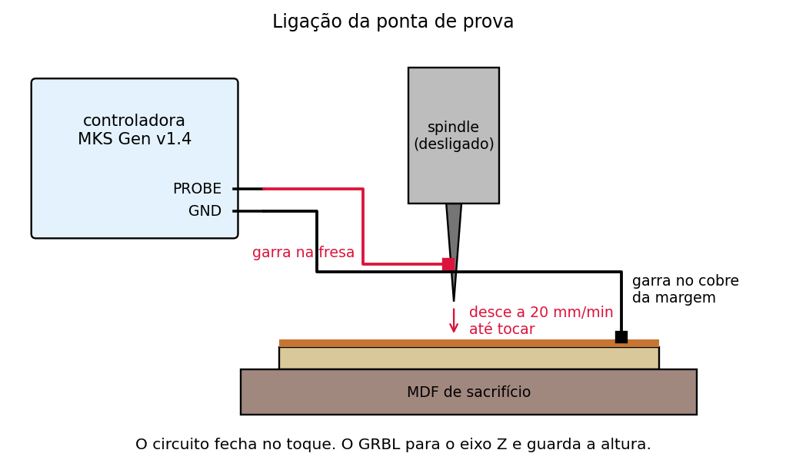
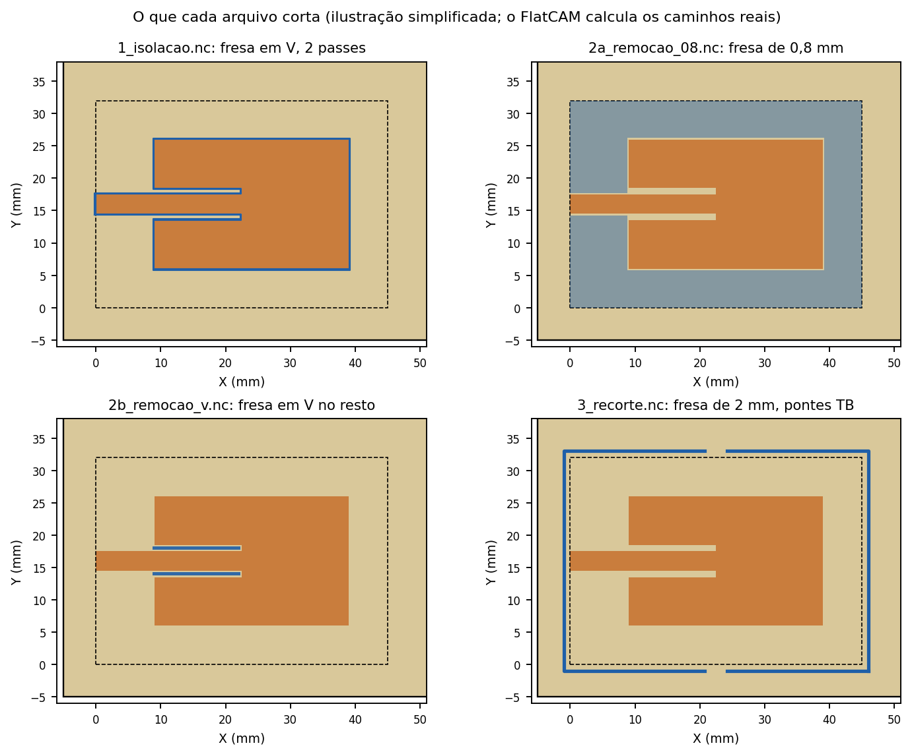
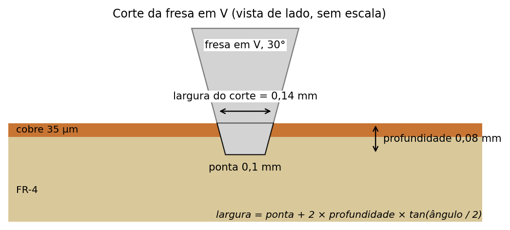
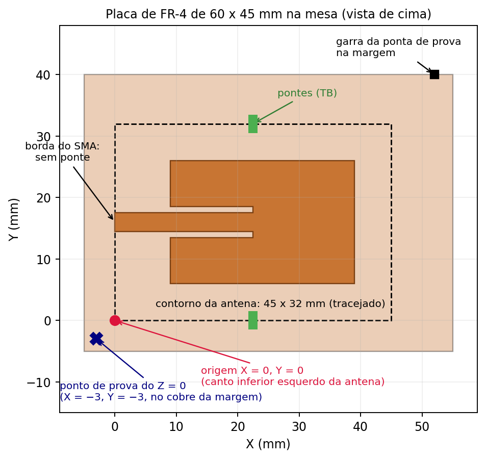
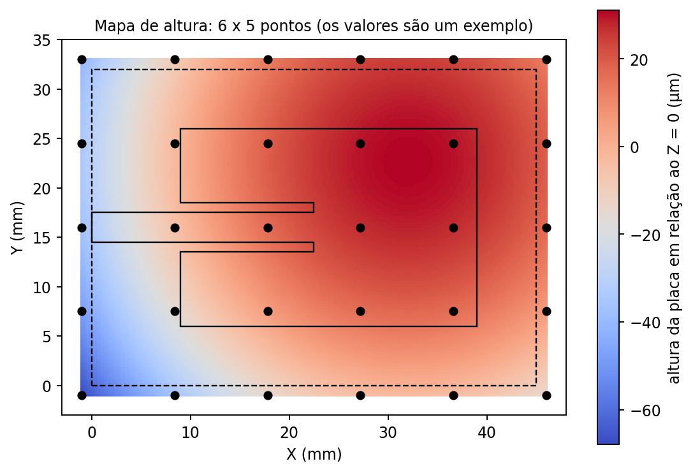

# Guia da fresadora CNC para fabricar antenas em placa de circuito

Este guia mostra como fresar uma antena em FR-4 na fresadora CNC do laboratório, do
arquivo da antena até a placa pronta para soldar o conector. Ele usa só programas livres
e de código aberto, que rodam no Windows e no Linux.

O exemplo do guia é o sensor patch de [patch_2g45](../patch_2g45). Para outra antena, troque
os arquivos e mantenha os passos.

Este guia substitui o guia anterior do laboratório. As mudanças principais são:

- programas livres no lugar do Easel e do conversor online;
- o spindle comandado pelo programa (`M3 S...`), sem partida manual do inversor;
- o mapa de altura da placa (*autolevel*), necessário para cortar só os 35 µm de cobre;
- o home com `$H`, e não com `$X`;
- o botão de emergência só para emergências.

## Sumário

1. [Segurança](#1-segurança)
2. [A máquina](#2-a-máquina)
3. [Os programas](#3-os-programas)
4. [Configuração da máquina (uma vez)](#4-configuração-da-máquina-uma-vez)
5. [Preparar o G-code no FlatCAM](#5-preparar-o-g-code-no-flatcam)
6. [Ligar, conectar e fazer o home](#6-ligar-conectar-e-fazer-o-home)
7. [Fixar a placa e definir a origem](#7-fixar-a-placa-e-definir-a-origem)
8. [Mapa de altura da placa](#8-mapa-de-altura-da-placa)
9. [Usinar](#9-usinar)
10. [Conferir a placa](#10-conferir-a-placa)
11. [Problemas comuns](#11-problemas-comuns)
12. [O que mais a máquina faz](#12-o-que-mais-a-máquina-faz)
13. [Lista de verificação para imprimir](#13-lista-de-verificação-para-imprimir)

---

## 1. Segurança

Leia esta seção antes de ligar a máquina pela primeira vez.

- **Pó de FR-4.** O pó de fibra de vidro faz mal aos pulmões e irrita a pele e os olhos.
  - Ligue o aspirador perto da fresa durante todo o corte.
  - Use máscara PFF2 e óculos de proteção.
  - Limpe a mesa com o aspirador. Não use ar comprimido, porque ele espalha o pó no ar.
- **Fresa.** As fresas de placa de circuito têm a ponta muito fina e quebram com facilidade.
  Com o spindle ligado, mantenha as mãos fora da área de trabalho.
- **Ruído.** O spindle passa de 10 000 rpm. Use protetor auricular em cortes longos.
- **Parada.** Saiba onde ficam os três modos de parar a máquina:

| Situação | O que fazer | Efeito |
|---|---|---|
| Quer olhar o corte de perto | pausa: botão *Pause* do bCNC ou a tecla `!` | os eixos param; o spindle continua a girar |
| Quer cancelar o trabalho | *Stop* ou *Reset* do bCNC (`Ctrl+X`) | os eixos e o spindle param; a máquina perde a posição e pede um novo home |
| Perigo para pessoas ou para a máquina | botão de emergência (cogumelo vermelho) | corta a energia |

O botão de emergência é só para emergências. Para parar um trabalho, use o *Stop* do bCNC.

---

## 2. A máquina

| Item | Valor | De onde vem |
|---|---|---|
| Controladora | MKS Gen v1.4 (ATmega2560) com GRBL 1.1 | guia anterior; confirme com `$I` |
| Curso útil X x Y x Z | 240 x 250 x 65 mm | `$130`, `$131`, `$132` |
| Resolução dos eixos | 1/640 mm = 1,6 µm por passo | `$100` a `$102` = 640 passos/mm |
| Velocidade máxima | 468 mm/min nos três eixos | `$110` a `$112` |
| Aceleração | 50 mm/s² em X e Y; 17 mm/s² em Z | `$120` a `$122` |
| Spindle | 550 a 12 000 rpm, comandado por `M3 S...` | `$30`, `$31`; inversor ligado à controladora |
| Home | fins de curso nos três eixos; Z sobe primeiro, depois X vai para a direita e Y para trás | `$22=1`, `$23=2` |
| Ponta de prova | entrada de *probe* ativa | `$6=1` |

A resolução de 1,6 µm é muito menor que a precisão real. A precisão real depende da folga
dos fusos e da rigidez da máquina. Para placas de antena, espere cerca de ±0,05 mm.

A velocidade máxima de 468 mm/min é baixa, mas é suficiente para FR-4. Os avanços deste
guia ficam abaixo dela.

---

## 3. Os programas

Todos os programas abaixo são livres e de código aberto.

| Programa | Licença | Para que serve | Obrigatório |
|---|---|---|---|
| [FlatCAM](http://flatcam.org) | MIT | lê o Gerber e gera o G-code: isolação, remoção de cobre e recorte da placa | sim |
| [bCNC](https://github.com/vlachoudis/bCNC) | GPL-2.0 | envia o G-code ao GRBL; faz o home, a ponta de prova e o mapa de altura | sim |
| [CAMotics](https://camotics.org) | GPL-2.0 | simula o G-code em 3D antes do corte | não |
| [LibreCAD](https://librecad.org) | GPL-2.0 | abre e edita DXF; abre DWG | não |
| [KiCad](https://www.kicad.org) | GPL-3.0 | desenha antenas novas e grava o Gerber | não |

### Instalação no Linux (Mint 22 ou Ubuntu 24.04)

Abra um terminal, cole o comando abaixo e tecle Enter. Ele instala todos os programas da
tabela e pede a senha do computador quando precisar.

```bash
URL=https://raw.githubusercontent.com/prof-davifr/openEMS-lab/main
curl -fsSL $URL/fabricacao/guia_cnc/instalar_linux.sh | bash
```

Espere a mensagem **INSTALACAO OK**. Depois, saia da sessão e entre de novo, para o bCNC ter
acesso à porta USB. Os programas ficam no menu de aplicativos. No terminal, os comandos são
`flatcam`, `bCNC`, `librecad`, `kicad` e `camotics`.

O script [instalar_linux.sh](instalar_linux.sh) roda os comandos abaixo. Para instalar à mão,
rode os mesmos comandos, na mesma ordem.

**1. Pacotes do sistema, com o LibreCAD e o KiCad:**

```bash
sudo apt update
sudo apt install -y git curl python3-tk pipx librecad kicad \
    libgl1 libegl1 libxkbcommon-x11-0 libxcb-xinerama0 libxcb-cursor0 \
    libxcb-icccm4 libxcb-image0 libxcb-keysyms1 libxcb-randr0 \
    libxcb-render-util0 libxcb-shape0 libxcb-xkb1
```

**2. Acesso à porta USB da CNC.** Depois deste comando, saia da sessão e entre de novo.

```bash
sudo usermod -aG dialout $USER
```

**3. bCNC:**

```bash
pipx ensurepath
pipx install bCNC
```

**4. FlatCAM.** O FlatCAM não tem pacote para Linux. O código-fonte é de 2022 e precisa do
Python 3.10 e de versões antigas das bibliotecas. O `uv` instala um Python 3.10 só para o
FlatCAM, sem mexer no Python do sistema.

```bash
curl -LsSf https://astral.sh/uv/install.sh | sh
export PATH="$HOME/.local/bin:$PATH"
D=~/.local/share/flatcam-beta
git clone --depth 1 -b Beta https://bitbucket.org/jpcgt/flatcam.git $D/fonte
uv venv -p 3.10 $D/venv
VIRTUAL_ENV=$D/venv uv pip install \
    pyqt5 "numpy<1.24" "matplotlib<3.7" "shapely==1.8.5.post1" \
    "vispy==0.9.6" rtree pyopengl "ortools<9.5" "svg.path<6" simplejson \
    freetype-py fontTools rasterio lxml "ezdxf<1.0" qrcode "reportlab<4" \
    "svglib<1.5" dill pyserial "Pillow<10"
```

Para abrir o FlatCAM instalado à mão:

```bash
cd ~/.local/share/flatcam-beta/fonte && ../venv/bin/python FlatCAM.py
```

**5. CAMotics (opcional).** O CAMotics só tem um pacote feito para o Debian. Se ele não
instalar, confira o G-code na vista do CNCJob do FlatCAM e no bCNC.

```bash
C=https://camotics.org/builds/release/debian-stable-64bit
cd /tmp
curl -fLO $C/camotics_1.2.0_amd64.deb
sudo apt install -y ./camotics_1.2.0_amd64.deb
```

### Instalação no Windows

**FlatCAM.** Baixe o instalador em <http://flatcam.org/download> e instale.

**bCNC.**

1. Instale o Python 3 de <https://www.python.org>. Na primeira tela, marque
   **Add python.exe to PATH**.
2. Abra o Prompt de Comando e rode `pip install bCNC`.
3. Para abrir o bCNC, rode `python -m bCNC`.

**LibreCAD, KiCad e CAMotics.** Baixe o instalador de cada um nas páginas da tabela acima.

### Por que o FlatCAM recebe o Gerber, e não o DXF

O Gerber e o DXF têm só a geometria. Nenhum dos dois depende da máquina: a fresa, a
profundidade e o avanço ficam no G-code, e quem gera o G-code é o FlatCAM.

A diferença está no modo como o FlatCAM lê cada formato:

- O Gerber diz o que é cobre. O FlatCAM lê o patch como uma **área**.
- O FlatCAM lê cada polilinha fechada do DXF como uma **linha**, e todas as camadas juntas.
  Com uma linha, a isolação corta dos dois lados dela, isto é, também por dentro do patch.

Por isso, use o Gerber no FlatCAM. O DXF serve para conferir o desenho no LibreCAD, para
cotar e para outros programas de CAM.

---

## 4. Configuração da máquina (uma vez)

Faça esta seção na primeira vez e depois de qualquer manutenção. Anote os resultados no
caderno do laboratório.

### 4.1 Conectar o bCNC

1. Ligue o cabo USB entre a controladora e o computador.
2. Abra o bCNC.
3. Na aba **File**, escolha a porta:
   - no Windows, `COM3` ou outro número (veja em Gerenciador de Dispositivos > Portas);
   - no Linux, `/dev/ttyUSB0` ou `/dev/ttyACM0`.
4. Escolha a velocidade `115200` e o controlador `GRBL1`.
5. Clique em **Open**. O estado aparece no alto da tela.

O estado **Alarm** depois da conexão é normal. O GRBL fica em alarme até o home, porque ele
ainda não sabe a posição da máquina.

### 4.2 Conferir o firmware e os parâmetros

Os comandos abaixo vão na linha de comando do bCNC (ou na aba **Terminal**).

1. Rode `$I` e anote a versão do GRBL.
2. Rode `$$` e compare cada valor com a tabela do [apêndice](#apêndice-parâmetros-do-grbl).
3. Para mudar um valor, rode `$número=valor`. Por exemplo: `$20=1`.

O guia anterior tem três pontos para revisar com o professor:

- **`$24` e `$25` estão trocados.** O `$24` é o avanço lento, que encontra a posição exata
  do fim de curso. O `$25` é o avanço rápido de busca. Hoje o lento vale 1500 e o rápido
  vale 100. Com `$24=50` e `$25=400`, o home fica mais rápido e mais repetitivo.
- **`$20=0` desliga os limites por software.** Com o home ativo e `$130` a `$132` corretos,
  `$20=1` faz o GRBL recusar um movimento que passa do curso, antes de a máquina bater.
- **O `$122` aparece duas vezes** na lista do guia anterior. Ele vale 17.

### 4.3 Testar o spindle

1. Faça o home (seção 6).
2. Suba o eixo Z até a fresa ficar longe da mesa.
3. Rode `M3 S6000`. O spindle tem de girar no sentido horário, visto de cima.
4. Compare a rotação no visor do inversor com 6000 rpm.
5. Repita com `S3000` e `S12000`.
6. Rode `M5`. O spindle tem de parar.
7. Anote o tempo que o inversor leva para chegar a 12 000 rpm. Este tempo é o *dwell* do
   FlatCAM (seção 5.5).

Se a rotação no visor for diferente do valor de `S`, ajuste a escala da entrada analógica do
inversor, ou mude `$30` e `$31` para os limites reais do inversor.

### 4.4 Testar a ponta de prova

A ponta de prova usa duas garras: uma na fresa e outra no cobre da placa. Quando a fresa
toca o cobre, o circuito fecha, e o GRBL para o eixo Z.



**Desligue o spindle antes de pôr a garra na fresa.**

1. Ligue a garra de prova à entrada *probe* da controladora. Ligue a garra de terra ao GND
   da controladora.
2. Prenda uma garra na fresa e a outra num pedaço de placa com cobre.
3. Rode `?` com as garras separadas. A resposta **não** pode ter `Pn:P`.
4. Encoste uma garra na outra e rode `?` de novo. A resposta tem de ter `Pn:P`.

Se `Pn:P` aparecer sem contato, a carcaça do spindle provavelmente está ligada ao terra
da controladora. Nesse caso, a fresa e o cobre já estão ligados antes do toque. Resolva
isto antes de usar a ponta de prova. Se `Pn:P` não aparecer com contato, mude `$6`
(de 1 para 0, ou de 0 para 1).

### 4.5 Conferir a escala dos eixos

1. Fixe uma régua de aço ou um paquímetro na mesa, alinhado com o eixo X.
2. Rode `G91 G0 X50` e meça o deslocamento real. Depois rode `G90`.
3. Repita para Y e Z (para Z, use 10 mm).

Se o deslocamento real for diferente de 50,0 mm, corrija com
`$100 = 640 × 50 / deslocamento medido` (`$101` para Y, `$102` para Z). Um erro de escala de
1 % muda a frequência de uma antena em cerca de 1 %.

---

## 5. Preparar o G-code no FlatCAM

O resultado desta seção são quatro arquivos de G-code, cada um com uma fresa só:

| Arquivo | Fresa | Trabalho |
|---|---|---|
| `1_isolacao.nc` | em V, 30°, ponta de 0,1 mm | contorno fino em volta do cobre que fica |
| `2a_remocao_08.nc` | de topo, 0,8 mm | remoção da maior parte do cobre que sobra |
| `2b_remocao_v.nc` | em V, a mesma da isolação | remoção do cobre onde a fresa de 0,8 mm não entra |
| `3_recorte.nc` | de topo ou "milho", 1,5 a 2 mm | recorte da placa |

Grave sempre uma fresa por arquivo. Com o pós-processador deste guia, o G-code não para
para a troca de fresa. Um arquivo com duas fresas continua o corte com a fresa errada.



A remoção de todo o cobre é necessária em antenas. Uma ilha de cobre solta perto do patch
muda a ressonância.

### 5.1 Abrir os arquivos

1. Em **Edit > Preferences > General**, escolha a unidade **MM**.
2. Em **File > Open > Open Gerber**, abra os dois arquivos da antena:
   - `patch_2g45-F_Cu.gbr`, o cobre de cima;
   - `patch_2g45-Edge_Cuts.gbr`, o contorno da placa.
3. Confira as medidas com a ferramenta de distância (**Tools > Distance Tool**). A placa
   tem de medir 45 x 32 mm.

A origem (0, 0) dos arquivos é o canto inferior esquerdo da placa. Na máquina, a origem vai
para o mesmo ponto (seção 7).

### 5.2 Isolação com a fresa em V

A fresa em V corta mais largo quando desce mais:

    largura do corte = ponta + 2 × profundidade × tan(ângulo / 2)

Com a ponta de 0,1 mm, o ângulo de 30° e a profundidade de 0,08 mm, a largura é 0,14 mm.



1. Selecione o objeto `F_Cu` e abra **Tools > Isolation Tool**.
2. Na tabela de ferramentas, escolha o tipo **V** e preencha a ponta (0,1 mm), o ângulo (30°)
   e a profundidade (−0,08 mm). O FlatCAM calcula o diâmetro do corte.
3. Escolha 2 passes, com 20 % de sobreposição.
4. Clique em **Generate Geometry**.

### 5.3 Remoção do cobre que sobra

1. Selecione o objeto `F_Cu` e abra **Tools > NCC Tool** (*Non-Copper Clearing*).
2. Em **Reference**, escolha **Reference Object** e depois o objeto `Edge_Cuts`. Assim, o
   FlatCAM remove o cobre na placa inteira, e não só em volta do patch.
3. Ponha duas ferramentas na tabela: a de topo de 0,8 mm e a fresa em V do passo anterior.
4. Marque **Rest** (usinagem do resto). A fresa de 0,8 mm remove a maior parte. A fresa em V
   remove o cobre onde a de 0,8 mm não entra, como as fendas de 1 mm do inset.
5. Use 40 % de sobreposição e profundidade de −0,08 mm.
6. Clique em **Generate Geometry**.

### 5.4 Recorte da placa

1. Abra **Tools > Cutout Tool** e escolha o objeto `Edge_Cuts`.
2. Escolha a fresa de 1,5 a 2 mm, a profundidade total de −1,7 mm e **Multi-Depth** com
   0,4 mm por passe.
3. Em **Gap type** (as pontes que seguram a placa), escolha **TB**. As pontes ficam nas
   bordas de cima e de baixo, e a borda do conector fica sem ponte.
4. Use pontes de 1,5 mm e clique em **Generate Geometry** (recorte retangular).

Numa antena com conector de borda, a borda do conector tem de ficar reta e limpa. Não ponha
ponte nesta borda.

### 5.5 Gerar o G-code

Para cada geometria (isolação, remoção e recorte):

1. Selecione a geometria e preencha os parâmetros da tabela abaixo.
   - A geometria da remoção tem duas fresas. Na tabela de ferramentas da geometria,
     selecione só uma fresa antes de gerar o CNCJob. Depois, repita com a outra fresa.
2. Em **Preprocessor**, escolha **GRBL_11_no_M6**. Cada arquivo usa uma fresa só, então o
   arquivo não precisa de troca de ferramenta.
3. Em **Dwell**, ponha o tempo de aceleração do inversor (seção 4.3), por exemplo 4 s. O
   G-code espera este tempo depois do `M3`, antes de descer a fresa.
4. Clique em **Generate CNCJob object**.
5. Selecione o objeto CNCJob e clique em **Save CNC Code**. Use os nomes da tabela do início
   da seção 5.

Valores iniciais para FR-4 nesta máquina. Ajuste os valores depois do teste numa sobra de placa.

| Parâmetro | Isolação (V 30°) | Remoção (topo 0,8 mm) | Recorte (topo 1,5 a 2 mm) |
|---|---|---|---|
| Rotação | 12 000 rpm | 12 000 rpm | 12 000 rpm |
| Avanço em XY | 150 mm/min | 120 mm/min | 120 mm/min |
| Avanço de mergulho | 50 mm/min | 40 mm/min | 30 mm/min |
| Profundidade | −0,08 mm | −0,08 mm | −1,7 mm, 0,4 mm por passe |
| Altura de deslocamento (*Travel Z*) | 2 mm | 2 mm | 2 mm |
| Altura no fim (*End move Z*) | 15 mm | 15 mm | 15 mm |

O cobre tem 35 µm. A profundidade de 0,08 mm corta o cobre com folga, mas só funciona com o
mapa de altura (seção 8).

### 5.6 Conferir o G-code (recomendado)

1. Abra cada arquivo no CAMotics e veja a simulação do corte.
2. Confira se a fresa não passa por dentro do patch nem da linha.
3. Confira se o recorte não tem ponte na borda do conector.
4. Confira se cada arquivo tem uma fresa só.

---

## 6. Ligar, conectar e fazer o home

1. Confira se nada está no caminho dos eixos e da fresa.
2. Ligue a máquina na tomada e gire o botão de emergência no sentido da seta para soltá-lo.
3. Conecte o bCNC (seção 4.1). O estado fica em **Alarm**.
4. Clique em **Home** no bCNC (ou rode `$H`). A ordem do movimento é:
   - Z sobe até o fim de curso;
   - X vai para a direita e Y vai para trás, juntos, até os fins de curso.
5. Confira se o estado mudou para **Idle**.

Não use `$X` para começar o trabalho. O `$X` tira o alarme sem o home, e a máquina fica sem
referência. Use `$X` só para sair de um alarme, por exemplo depois de um fim de curso
acionado sem querer. Depois do `$X`, faça o home de novo.

---

## 7. Fixar a placa e definir a origem

### 7.1 Fixar a placa

1. Use uma placa de FR-4 pelo menos 10 mm maior que a antena em X e em Y. Para o sensor
   de 45 x 32 mm, use 60 x 45 mm ou mais. A margem segura as pontes e recebe a garra da
   ponta de prova.
2. Ponha uma placa de sacrifício (MDF) na mesa. O recorte atravessa o FR-4 e entra nela.
3. Limpe a face de baixo da placa de FR-4 com álcool isopropílico.
4. Cole a placa no MDF com fita dupla face em toda a área, sem bolhas. Uma bolha levanta o
   cobre, e a fresa corta fundo demais naquele ponto.
5. Ponha a face da antena (a face de cima) para cima. Em antenas com plano de terra, a face
   de baixo fica intacta.
6. Alinhe a borda da placa com o eixo X da máquina.

### 7.2 Definir a origem em X e Y



1. Ponha a fresa em V no spindle.
2. Mova a fresa para o ponto que vai ser o canto inferior esquerdo da antena, 5 mm para
   dentro de cada borda da placa de FR-4.
3. Clique em **X=0** e **Y=0** no bCNC (ou rode `G10 L20 P1 X0 Y0`).

### 7.3 Definir a origem em Z com a ponta de prova

Escolha um ponto de prova na margem da placa, fora da antena, por exemplo X = −3, Y = −3.
Use sempre este mesmo ponto para o Z = 0. A margem fica com cobre até o fim do trabalho,
então o ponto funciona em todas as trocas de fresa.

**Desligue o spindle antes de pôr a garra na fresa.**

1. Prenda uma garra na fresa e a outra no cobre da margem.
2. Rode `G90 G0 X-3 Y-3` e desça a fresa até cerca de 2 mm acima do cobre.
3. Rode os comandos abaixo, um de cada vez:

   ```
   G91 G38.2 Z-5 F20
   G10 L20 P1 Z0
   G90 G0 Z2
   ```

   - O primeiro desce a fresa a 20 mm/min até o toque.
   - O segundo define Z = 0 no ponto do toque.
   - O terceiro sobe a fresa para 2 mm.

4. Deixe as garras ligadas para o mapa de altura.

Se a fresa descer 5 mm sem tocar, o GRBL para com o alarme `ALARM:5`. Confira as garras e
faça o home de novo.

---

## 8. Mapa de altura da placa

A placa nunca fica perfeitamente plana: a mesa tem inclinação, e a fita tem espessura
variável. Uma diferença de 0,05 mm já é maior que o cobre (35 µm). Sem o mapa, a fresa
corta fundo num lado e não corta o cobre no outro.

O bCNC mede a altura da placa em vários pontos com a ponta de prova. Depois, ele corrige o Z
do G-code durante o envio.



1. Abra `3_recorte.nc` no bCNC (**File > Open**). O recorte é o arquivo que cobre a maior
   área, então o mapa fica válido para todos os arquivos.
2. Na aba **Probe**, abra **Autolevel**.
3. Clique em **Margins** para usar os limites do G-code. Para o sensor, os limites vão de
   cerca de −1 a 46 mm em X e de −1 a 33 mm em Y.
4. Escolha a quantidade de pontos. Uma distância de cerca de 10 mm entre os pontos basta.
   Para o sensor, use 6 pontos em X e 5 em Y.
5. Confira a velocidade de prova (20 mm/min) e a altura de deslocamento (2 mm).
6. Clique em **Scan**. A máquina toca cada ponto.
7. Salve o mapa (**Save**), para usar de novo depois de uma falha.

Faça o mapa uma vez, antes do primeiro corte, enquanto todo o cobre ainda está inteiro. O
mapa vale para todos os arquivos. Se o mapa sumir quando você abrir outro arquivo, carregue
o mapa salvo (**Load**).

---

## 9. Usinar

Faça a primeira placa numa sobra de FR-4. Depois de medir o resultado, ajuste a profundidade
e o avanço.

### 9.1 Teste no ar (recomendado na primeira vez)

1. Depois da seção 7.3, a fresa fica em Z = 2, isto é, 2 mm acima do cobre. Nesta posição,
   rode `G10 L20 P1 Z-3`. Agora o Z = 0 fica 5 mm acima do cobre.
2. Rode `G0 Z10` e meça com uma régua: a ponta da fresa tem de ficar a cerca de 15 mm do
   cobre.
3. Envie `1_isolacao.nc` e veja o caminho da fresa no ar.
4. Defina o Z = 0 de novo com a ponta de prova (seção 7.3).

### 9.2 Isolação

1. Tire a garra da fresa.
2. Ligue o aspirador.
3. Confira se `1_isolacao.nc` está aberto e se o mapa de altura está ativo.
4. Clique em **Start**. O G-code liga o spindle (`M3`), espera o *dwell* e só então desce.
5. Acompanhe o primeiro minuto de perto. Se a fresa não cortar o cobre, ou se cortar fundo
   demais, clique em **Stop** e reveja o Z = 0.

### 9.3 Troca de fresa

Faça estes passos antes de cada arquivo novo:

1. Espere o fim do arquivo. O G-code desliga o spindle (`M5`) e sobe o Z.
2. Troque a fresa. Não mexa na placa e não faça o home.
3. Defina o Z = 0 de novo no mesmo ponto de prova (seção 7.3). Cada fresa tem um
   comprimento diferente.
4. Não refaça o mapa de altura. O mapa continua a valer.

### 9.4 Remoção e recorte

1. Faça a troca para a fresa de 0,8 mm e envie `2a_remocao_08.nc`.
2. Faça a troca para a fresa em V e envie `2b_remocao_v.nc`.
3. Faça a troca para a fresa de recorte e envie `3_recorte.nc`.
4. Depois do fim, corte as pontes com um estilete e lixe as bordas de leve.

---

## 10. Conferir a placa

1. Olhe a placa com uma lupa. Não pode sobrar cobre nas fendas do inset nem perto do patch.
2. Meça com o paquímetro e compare com o desenho cotado da antena:
   - L e W do patch;
   - a largura da linha;
   - a largura e a profundidade das fendas do inset;
   - as dimensões da placa.
3. Meça com o multímetro: o cobre de cima não pode ter continuidade com o plano de terra.
4. Anote as medidas, o lote da placa, as fresas e os parâmetros no caderno do laboratório.

Uma diferença de até 0,05 mm é normal. Se a linha ficar estreita e as fendas largas, a
fresa em V desceu fundo demais: diminua a profundidade ou confira o mapa de altura.

---

## 11. Problemas comuns

| Sintoma | Causa provável | O que fazer |
|---|---|---|
| A fresa não corta o cobre em uma parte da placa | sem mapa de altura, ou bolha na fita | faça o mapa de altura; cole a placa de novo |
| A fresa corta fundo demais em uma parte da placa | o mesmo | o mesmo |
| As linhas ficam mais finas que o desenho | fresa em V funda demais | diminua a profundidade; confira o ângulo e a ponta da fresa |
| A fresa quebra logo no início | o spindle ainda não estava na rotação | aumente o *dwell*; confira a seção 4.3 |
| O mapa de altura dá `ALARM:5` | a garra solta, ou um ponto fora do cobre | confira as garras e os limites do mapa |
| `Pn:P` sem contato | spindle ligado ao terra da controladora | isole a carcaça do spindle ou mude a ligação da garra |
| As medidas saem todas maiores ou menores na mesma proporção | escala dos eixos errada | faça a seção 4.5 |
| A posição muda durante o trabalho | o motor perdeu passos (avanço ou aceleração altos) | diminua o avanço; confira o aperto das polias e acoplamentos |
| `ALARM:1` ou `ALARM:2` sem motivo | ruído do inversor nos fins de curso | afaste os cabos dos fins de curso dos cabos do spindle |

---

## 12. O que mais a máquina faz

- **Furos.** O FlatCAM lê arquivos de furação (Excellon) do KiCad e gera o G-code dos furos.
  Os furos são necessários para antenas com curto ao plano de terra (patch de λ/4) e para
  conectores SMA de furo.
- **Placas de face dupla.** O home dá uma referência repetitiva. Com dois pinos de
  alinhamento na placa de sacrifício, o FlatCAM (**Tools > 2-Sided Tool**) espelha a face de
  baixo e mantém o alinhamento entre as faces.
- **Espaçadores e suportes.** A máquina corta acrílico e MDF. Por exemplo, ela corta as
  molduras de 3,0 mm que mantêm o gap entre o sensor e a amostra. Para estas peças, desenhe
  no LibreCAD e gere o G-code a partir do DXF (o bCNC e o FlatCAM fazem contornos e rebaixos
  em DXF).
- **Antenas novas.** Desenhe a antena no KiCad (camadas `F.Cu` e `Edge.Cuts`) e grave o
  Gerber, ou escreva a geometria em Python, como em `patch_2g45/geometria.py`. Depois, siga
  este guia a partir da seção 5.

---

## 13. Lista de verificação para imprimir

**Antes de ligar**

- [ ] Óculos, máscara PFF2 e aspirador prontos
- [ ] Nada no caminho dos eixos e da fresa
- [ ] Botão de emergência ao alcance

**Preparação**

- [ ] G-code gerado no FlatCAM com `GRBL_11_no_M6` e *dwell*, uma fresa por arquivo
- [ ] G-code conferido no CAMotics
- [ ] Máquina ligada, bCNC conectado, home com `$H`
- [ ] Placa colada sem bolhas, com margem de 5 mm ou mais
- [ ] Origem X e Y no canto inferior esquerdo da antena
- [ ] Z = 0 com a ponta de prova, no ponto de prova da margem
- [ ] Mapa de altura feito e salvo

**Para cada fresa**

- [ ] Spindle parado antes de pôr a garra na fresa
- [ ] Z = 0 no mesmo ponto de prova
- [ ] Garra retirada da fresa antes do *Start*
- [ ] Aspirador ligado
- [ ] Primeiro minuto acompanhado de perto

**No fim**

- [ ] Spindle parado e Z no alto
- [ ] Mesa limpa com o aspirador
- [ ] Medidas e parâmetros anotados no caderno

---

## Apêndice: parâmetros do GRBL

Valores lidos com `$$` e registrados no guia anterior. A coluna "Sugestão" mostra as mudanças
deste guia. Confirme cada mudança com o professor antes de gravar.

| Parâmetro | Valor | O que é | Sugestão |
|---|---|---|---|
| `$0` | 10 | duração do pulso de passo (µs) | |
| `$1` | 254 | tempo até desligar os motores parados (ms) | |
| `$2` | 5 | inversão do sinal de passo | |
| `$3` | 0 | inversão da direção dos eixos | |
| `$4` | 0 | inversão do sinal de habilitar | |
| `$5` | 0 | inversão dos fins de curso | |
| `$6` | 1 | inversão da ponta de prova | conferir com a seção 4.4 |
| `$10` | 3 | dados do relatório de estado | |
| `$11` | 0,020 | desvio nas junções (mm) | |
| `$12` | 0,002 | tolerância dos arcos (mm) | |
| `$13` | 0 | relatório em mm | |
| `$20` | 0 | limites por software | **1** |
| `$21` | 0 | limites por hardware | |
| `$22` | 1 | home ativo | |
| `$23` | 2 | direção do home (Y invertido) | |
| `$24` | 1500 | avanço lento do home, que localiza o fim de curso (mm/min) | **50** |
| `$25` | 100 | avanço rápido do home, que procura o fim de curso (mm/min) | **400** |
| `$26` | 244 | filtro dos fins de curso (ms) | |
| `$27` | 3,000 | recuo depois do home (mm) | |
| `$30` | 12000 | rotação máxima (rpm) | conferir com a seção 4.3 |
| `$31` | 550 | rotação mínima (rpm) | conferir com a seção 4.3 |
| `$32` | 0 | modo laser desligado | |
| `$100`, `$101`, `$102` | 640 | passos por mm em X, Y e Z | conferir com a seção 4.5 |
| `$110`, `$111`, `$112` | 468,75 | velocidade máxima em X, Y e Z (mm/min) | |
| `$120`, `$121` | 50 | aceleração em X e Y (mm/s²) | |
| `$122` | 17 | aceleração em Z (mm/s²) | |
| `$130`, `$131`, `$132` | 240, 250, 65 | curso máximo em X, Y e Z (mm) | |
