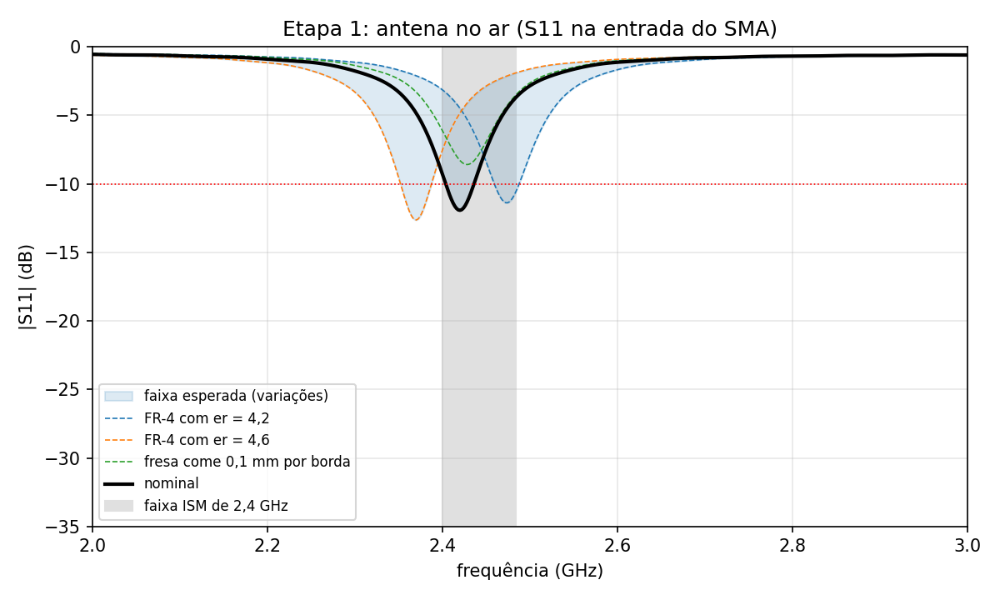
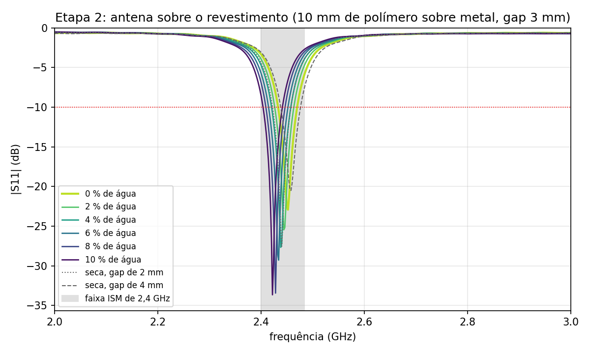
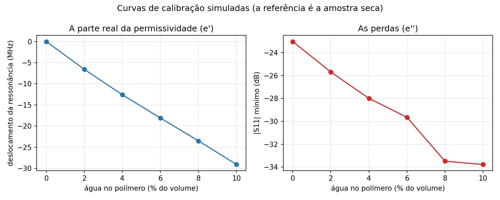

# Sensor patch de 2,45 GHz para umidade: fabricar na CNC e medir no VNA

Um sensor patch pequeno (placa de 45 x 32 mm) em FR-4, alimentado por uma linha de
microfita com inset, com um conector SMA na borda da placa. O patch fica voltado para
um revestimento de polímero sobre metal. A água no polímero muda a ressonância e o S11.

O trabalho tem duas etapas:

1. fabricar a placa na CNC e validar a antena no ar, contra a simulação;
2. medir o revestimento seco e úmido e comparar com as curvas de calibração simuladas.


## Por que 2,45 GHz

- A água tem er perto de 77 em 2,45 GHz; o polímero seco tem perto de 4. Um pouco de água
  muda muito a permissividade do revestimento.
- A água também tem perdas altas em 2,45 GHz (e'' perto de 9). Assim, a água muda duas
  grandezas: a frequência da ressonância (pela parte real) e o S11 mínimo (pelas perdas).
- Abaixo de 1 GHz, os sais dissolvidos na água pesam mais que a própria água. Acima de
  10 GHz, o campo do sensor entra pouco no revestimento. 2,45 GHz fica no meio, numa
  faixa ISM, e dentro de um VNA de 3 GHz.

## O que tem nesta pasta

| Arquivo | Para que serve |
|---|---|
| `gerber/patch_2g45-F_Cu.gbr`, `gerber/patch_2g45-Edge_Cuts.gbr` | **os arquivos para o FlatCAM**: cobre de cima e contorno da placa (veja o [guia da CNC](../guia_cnc/GUIA_CNC.md)) |
| `gerber/patch_2g45-B_Cu.gbr` | cobre de baixo: plano de terra inteiro (não vai à fresa) |
| `patch_2g45_gerber.zip` | os três Gerber num arquivo só |
| `patch_2g45.dxf` | o mesmo desenho em DXF, para conferir e cotar no LibreCAD ou usar em outro CAM |
| `resultados/desenho_cotado.png` | dimensões, para conferir a placa com o paquímetro |
| `resultados/resumo.md` | tabelas com os resultados esperados das duas etapas |
| `resultados/s11_ar.s1p` | S11 simulado no ar, em Touchstone, para abrir no programa do VNA |
| `resultados/s11_amostra_seca.s1p` | S11 simulado sobre a amostra seca |
| `resultados/calibracao_umidade.csv` | ressonância e S11 mínimo para cada fração de água |
| `resultados/s11_ar_variacoes.csv`, `s11_amostra.csv` | todas as curvas simuladas, para planilha |
| `resultados/*.png` | gráficos dos resultados esperados |
| `comparar.py` | compara as suas medições (`.s1p`) com a simulação e estima a água |
| `geometria.py`, `simular.py` | geram o DXF e o Gerber e refazem a simulação |

Não há arquivo de furação: o SMA de borda não precisa de furo.

### O arquivo DXF

O DXF tem só a geometria. A fresa, a profundidade, o avanço e a compensação do raio da fresa
são ajustes da sua máquina e ficam no programa de CAM.

No FlatCAM, use o Gerber e não o DXF. O FlatCAM lê as polilinhas do DXF como linhas, e não
como áreas; o [guia da CNC](../guia_cnc/GUIA_CNC.md#por-que-o-flatcam-recebe-o-gerber-e-não-o-dxf)
explica o problema.

- Formato DXF R12, que abre em qualquer programa de CAD ou CAM (LibreCAD, FreeCAD, Inkscape,
  bCNC e outros). O LibreCAD abre DWG, mas grava só DXF. Os programas que leem DWG também
  leem este DXF.
- Unidade: milímetro. Origem (0, 0): canto inferior esquerdo da placa.
- Vista de cima da face de cima. Não espelhe o desenho.
- Todas as linhas são polilinhas fechadas, em três camadas:

| Camada | Cor | O que é |
|---|---|---|
| `CONTORNO_PLACA` | branca ou preta (cor 7) | retângulo da placa, 45 x 32 mm (corte final) |
| `COBRE_CIMA` | vermelha | contorno do patch com a linha: o cobre que **fica** |
| `AREA_REMOVER` | azul | placa menos patch e linha: o cobre que **sai**, num polígono só |

As camadas `COBRE_CIMA` e `AREA_REMOVER` têm linhas em comum. Use uma ou a outra, conforme o
seu programa de CAM:

- para um rebaixo (*pocket*) com a área que sai, use `AREA_REMOVER`;
- para um desbaste em volta de ilhas, use `CONTORNO_PLACA` como limite e `COBRE_CIMA` como ilha.

## Material

- Placa de FR-4 de face dupla, 1,6 mm, cobre de 35 µm (1 oz), com pelo menos 60 x 45 mm.
  A margem em volta da antena segura a placa durante o recorte.
- Um conector SMA fêmea de borda (*end launch*) para placa de 1,6 mm.
- Fresas: uma em V de 30° com ponta de 0,1 mm, uma de topo de 0,8 mm e uma de 1,5 a 2 mm
  para o recorte (veja o [guia da CNC](../guia_cnc/GUIA_CNC.md)).
- Quatro espaçadores de plástico de 3 mm (arruelas de náilon, por exemplo).
- Amostras: chapas de metal com 10 mm de revestimento de polímero, de pelo menos
  100 x 80 mm. Uma fica seca, como referência.
- Paquímetro, balança, ferro de solda, estanho e álcool isopropílico.

## Etapa 1: fabricar e validar no ar

### Fabricação na CNC

Siga o [guia da fresadora CNC](../guia_cnc/GUIA_CNC.md). Ele usa este sensor como exemplo, com os
arquivos `gerber/patch_2g45-F_Cu.gbr` e `gerber/patch_2g45-Edge_Cuts.gbr`.

Para esta antena, preste atenção a três pontos:

- Remova **todo** o cobre de cima que fica fora do patch e da linha, inclusive dentro das
  fendas do inset. Cobre solto perto do patch muda a ressonância.
- Não frese a face de baixo. Ela é o plano de terra.
- Não ponha ponte na borda do SMA. Esta borda tem de ficar reta, e a linha tem de chegar
  até ela.

Depois da fabricação, meça com o paquímetro e anote: L, W, largura da linha, folga do
inset, profundidade do inset e espessura da placa. Compare com o desenho cotado.

A fresa em V corta mais largo quando desce mais. Se a folga do inset medir mais que 1,2 mm,
diminua a profundidade de corte na próxima placa.

### Montagem do SMA

1. Encaixe o SMA na borda, com o pino central apoiado sobre a linha, no centro dela.
2. Solde as duas pernas de baixo no plano de terra. As pernas de cima ficam sem solda,
   porque não há cobre na face de cima perto delas.
3. Solde o pino central na linha com pouca solda. Um bolo de solda muda a impedância.
4. Limpe o fluxo com álcool isopropílico.
5. Meça com o multímetro: o pino central não pode ter continuidade com o plano de terra.

### Medição no ar

1. Configure a varredura de 2,0 a 3,0 GHz, com pelo menos 401 pontos.
2. Ligue o cabo que vai ficar na antena e calibre na ponta dele: aberto, curto e carga de
   50 ohm (calibração SOL). Assim o plano de referência fica no conector, como na simulação.
3. Ligue a antena. Deixe-a longe de mesa metálica, de paredes e das mãos (pelo menos 30 cm).
4. Salve a medição em Touchstone (por exemplo, `ar.s1p`) e rode:

   ```bash
   python comparar.py ar.s1p
   ```

O script mostra a ressonância medida e a simulada, faz o gráfico `comparar.png` e estima o
er do FR-4 da sua placa.

### Resultados esperados no ar

| Caso | Ressonância | S11 mínimo | Faixa com S11 < -10 dB |
|---|---|---|---|
| **nominal** (FR-4 com er = 4,4) | **2,420 GHz** | **-11,9 dB** | **2,404 a 2,436 GHz** |
| FR-4 com er = 4,2 | 2,473 GHz | -11,4 dB | 2,459 a 2,488 GHz |
| FR-4 com er = 4,6 | 2,370 GHz | -12,6 dB | 2,352 a 2,387 GHz |
| fresa come 0,1 mm por borda | 2,428 GHz | -8,6 dB | não chega a -10 dB |



No ar, o mínimo é raso de propósito: o casamento foi ajustado para o sensor sobre a
amostra, que é a condição de uso. A etapa 1 confere a fabricação pela frequência, e não pela
profundidade do mínimo.

Critérios para dizer que a placa está boa:

- ressonância entre 2,36 e 2,48 GHz (a faixa que o er do FR-4 permite);
- um mínimo nítido, abaixo de cerca de -8 dB.

Sensibilidades, para entender um desvio no ar:

| O que muda | Efeito na ressonância |
|---|---|
| er do FR-4 +0,1 | cerca de -26 MHz |
| L do patch +0,1 mm | cerca de -7 MHz |
| fresa come +0,1 mm por borda | cerca de +8 MHz, e o mínimo fica mais raso |

## Etapa 2: medir a umidade no revestimento

### Montagem do sensor sobre a amostra

1. Cole os quatro espaçadores de 3 mm nos cantos da placa, do lado do patch, longe do cobre.
2. Apoie o sensor sobre a amostra, com o patch voltado para o polímero.
3. Alinhe a borda do SMA com a borda da amostra. O corpo do SMA passa uns 3 mm além do
   patch: se a amostra passar por baixo dele, o sensor não assenta e o gap muda.
4. Marque a posição do sensor na amostra. Meça sempre no mesmo lugar.

### Preparar as amostras úmidas

1. Pese cada amostra seca e anote a massa.
2. Deixe as amostras em água (ou numa câmara úmida) por tempos diferentes.
3. Seque a superfície com papel e pese de novo. A massa a mais é a água absorvida.
4. Calcule a fração de volume de água: (massa de água / 1 g/cm³) / volume do polímero.

A balança dá o valor de referência. O sensor tem de chegar perto dele.

### Medição

1. Configure a varredura de 2,30 a 2,60 GHz, com pelo menos 601 pontos, e calibre de novo.
2. Meça a amostra seca e salve (por exemplo, `seca.s1p`).
3. Compare com a simulação da amostra seca:

   ```bash
   python comparar.py --amostra seca.s1p
   ```

4. Meça as amostras úmidas e salve um arquivo para cada uma.
5. Estime a água em cada amostra úmida:

   ```bash
   python comparar.py --umidade seca.s1p umida_1.s1p umida_2.s1p
   ```

   A referência é a SUA medição da amostra seca. Assim, o erro do er do FR-4 quase se cancela.
6. Compare a estimativa do sensor com o valor da balança.

### Resultados esperados sobre a amostra

Amostra simulada: 10 mm de polímero com er = 4 e tand = 0,01 sobre metal, gap de 3 mm.
A água entra pelo modelo de mistura CRIM.

| Água no polímero | er / tand do polímero | Ressonância | Deslocamento | S11 mínimo |
|---|---|---|---|---|
| **0 % (seca)** | **4,00 / 0,010** | **2,451 GHz** | **0** | **-23,0 dB** |
| 2 % | 4,56 / 0,019 | 2,445 GHz | -7 MHz | -25,7 dB |
| 4 % | 5,16 / 0,027 | 2,439 GHz | -13 MHz | -28,0 dB |
| 6 % | 5,80 / 0,034 | 2,433 GHz | -18 MHz | -29,6 dB |
| 8 % | 6,47 / 0,040 | 2,428 GHz | -24 MHz | -33,5 dB |
| 10 % | 7,18 / 0,046 | 2,422 GHz | -29 MHz | -33,8 dB |





O que os números dizem:

- Cada 1 % de água desloca a ressonância cerca de -2,9 MHz. Para ver isso, use uma
  varredura estreita: de 2,30 a 2,60 GHz, com pelo menos 601 pontos (passo de 0,5 MHz).
  Calibre de novo para esta faixa.
- As perdas da água deixam o mínimo mais fundo, porque o sensor seco fica um pouco abaixo do
  casamento perfeito. Com mais perdas, o mínimo pode voltar a subir.
- O gap pesa muito. Com a amostra seca, um gap de 2 mm dá 2,440 GHz (-11 MHz) e um gap de
  4 mm dá 2,457 GHz (+6 MHz). Um milímetro de erro no espaçador vale de 2 a 4 % de água.
  Use espaçadores com 0,1 mm de precisão.
- Do ar para a amostra seca, a ressonância sobe cerca de 31 MHz (de 2,420 para 2,451 GHz).
  Esta diferença quase não depende do er do FR-4. Ela confere a montagem antes das medições
  com água.

## Como interpretar a comparação

- **No ar, a frequência saiu deslocada, mas o mínimo é fundo.** É o caso mais comum. O
  fabricante do FR-4 não garante o er em 2,4 GHz; ele varia de cerca de 4,2 a 4,6 entre
  lotes. Confira as dimensões com o paquímetro. Se elas estiverem certas, a diferença vem do
  er, e o `comparar.py` estima o valor.
- **O mínimo ficou raso (acima de -10 dB).** Confira a solda do SMA, a folga e a
  profundidade do inset e se sobrou cobre perto do patch.
- **Não há ressonância nenhuma.** Confira a calibração, o cabo e a continuidade entre o pino
  central e a linha.
- **Sobre a amostra, a medição muda quando você tira e põe o sensor.** O gap mudou. Confira
  os espaçadores e se a amostra passa por baixo do SMA.
- **A estimativa de água fica longe da balança.** O modelo de mistura (CRIM) supõe a água
  espalhada no polímero. Água só na superfície, ou em bolhas, dá outra curva. Uma curva de
  calibração medida (sensor contra balança) é o próximo passo do projeto.

## Como refazer a simulação

Copie esta pasta para `Documentos/openEMS-notebooks`. No JupyterLab do openEMS Lab, abra um
terminal (File > New > Terminal), entre na pasta com `cd patch_2g45` e rode:

```bash
python geometria.py      # DXF, Gerber e desenho cotado (alguns segundos)
python simular.py        # 12 simulações e gráficos (de 30 a 90 minutos)
```

Para mudar o sensor, mude os valores da classe `Antena` em `geometria.py`. Para mudar a
amostra (espessura, er, gap), mude a classe `Amostra` em `simular.py`. A simulação, o DXF e o
Gerber usam o mesmo polígono, então os três ficam sempre iguais.
