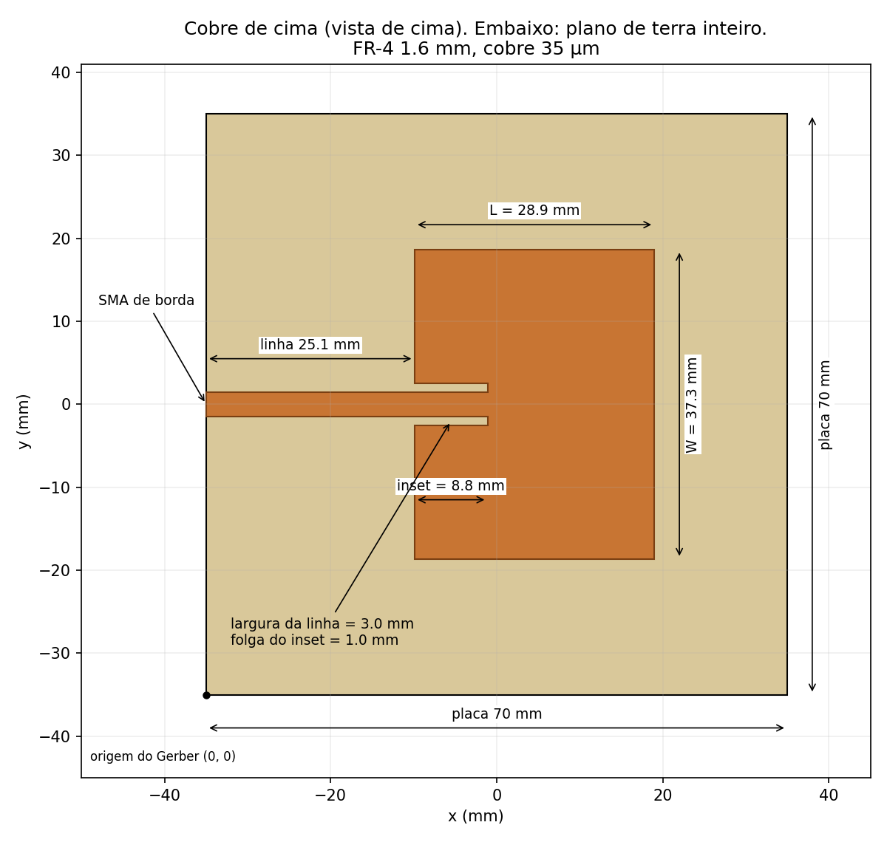
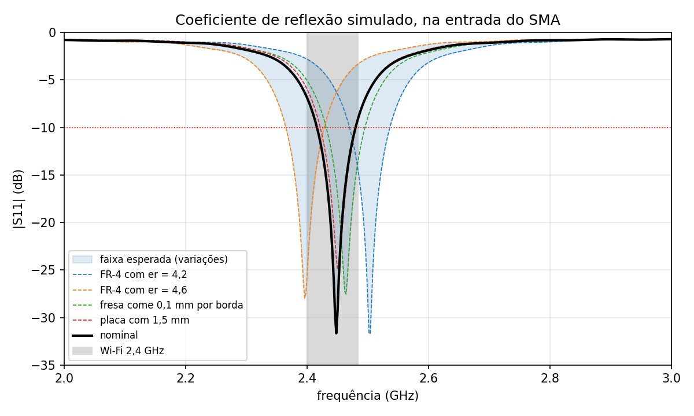
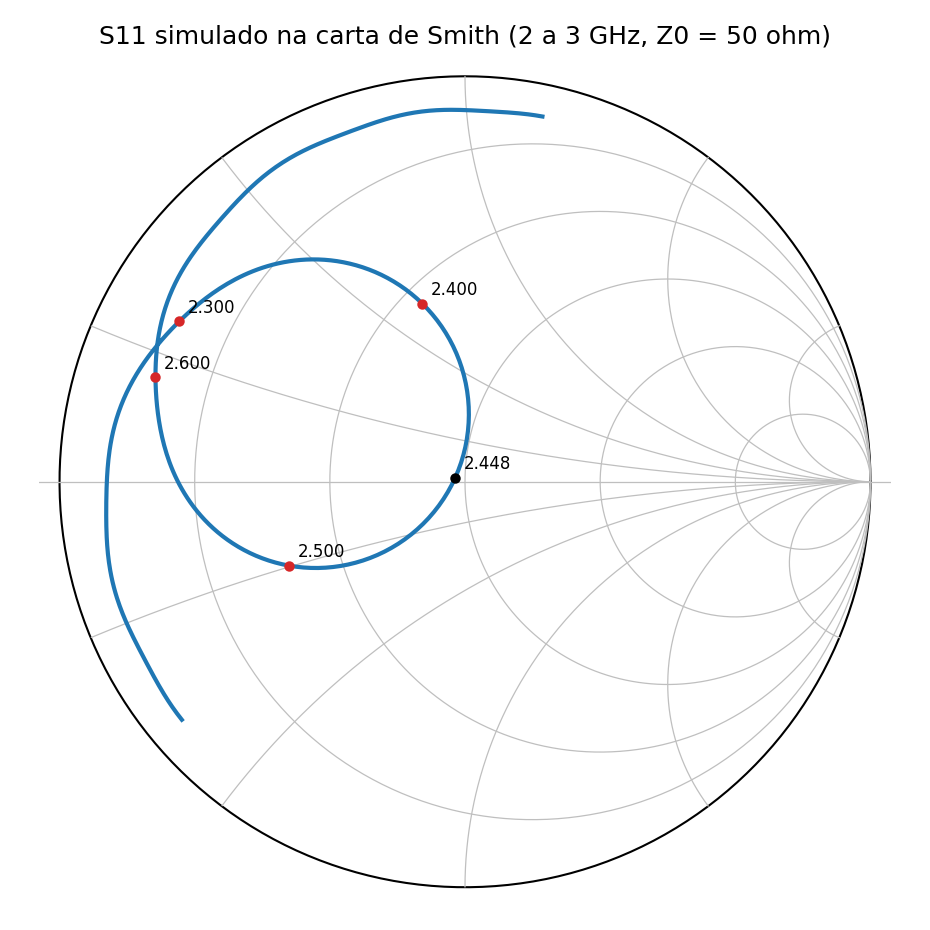
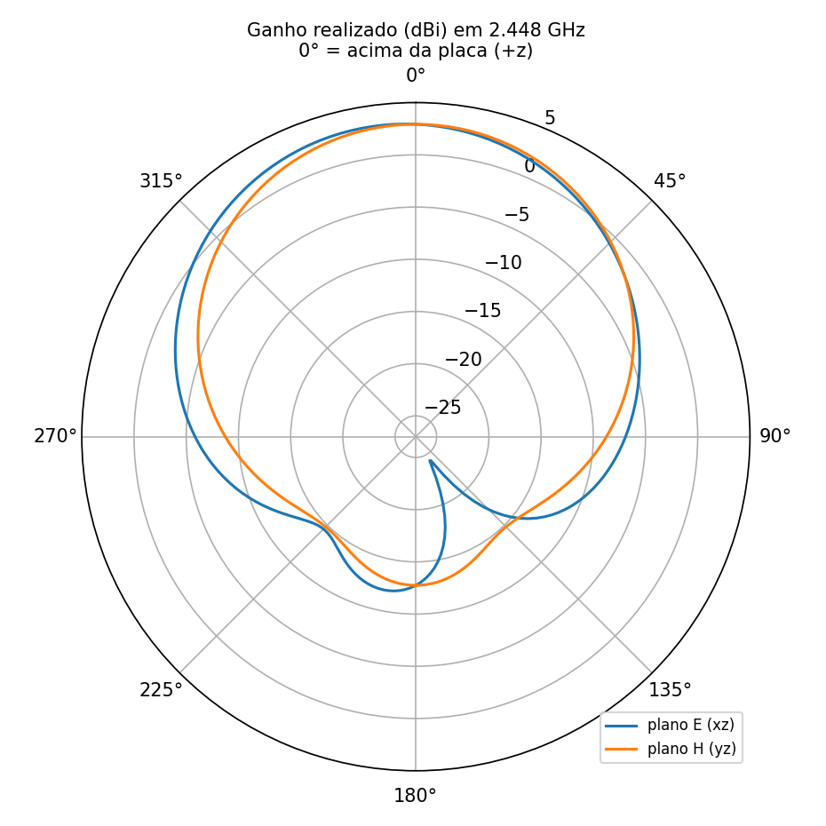

# Antena patch de 2,45 GHz: fabricar na CNC e medir no VNA

Uma antena patch retangular em FR-4, alimentada por uma linha de microfita com inset, com
um conector SMA na borda da placa. Ela ressoa em 2,45 GHz, na faixa do Wi-Fi.

O objetivo é fabricar a placa na fresadora CNC, medir o S11 no VNA e comparar a medição
com a simulação.



## O que tem nesta pasta

| Arquivo | Para que serve |
|---|---|
| `patch_2g45_gerber.zip` | os três Gerber num arquivo só, para levar para o computador da CNC |
| `gerber/patch_2g45-F_Cu.gbr` | cobre de cima: patch e linha (é a única face que vai à fresa) |
| `gerber/patch_2g45-B_Cu.gbr` | cobre de baixo: plano de terra inteiro (não fresar) |
| `gerber/patch_2g45-Edge_Cuts.gbr` | contorno da placa, 70 x 70 mm |
| `resultados/desenho_cotado.png` | dimensões, para conferir a placa com o paquímetro |
| `resultados/resumo.md` | tabela com os resultados esperados |
| `resultados/s11_simulado.s1p` | S11 simulado em Touchstone, para abrir no programa do VNA |
| `resultados/s11_simulado.csv` | o mesmo S11, com a impedância de entrada, para planilha |
| `resultados/s11_variacoes.csv` | S11 das variações (FR-4 diferente, fresa, espessura) |
| `resultados/s11.png`, `smith.png`, `diagrama.png` | gráficos dos resultados esperados |
| `comparar.py` | compara o seu `.s1p` medido com a simulação |
| `geometria.py`, `simular.py` | geram o Gerber e refazem a simulação |

Não há arquivo de furação: o SMA de borda não precisa de furo.

## Material

- Placa de FR-4 de face dupla, 1,6 mm, cobre de 35 µm (1 oz), com pelo menos 70 x 70 mm.
- Um conector SMA fêmea de borda (*end launch*) para placa de 1,6 mm.
- Fresas: uma em V (ou de 0,2 a 0,4 mm) para o contorno do cobre, uma de topo de 1 a 2 mm
  para remover o cobre e uma de 1 a 2 mm para cortar a placa.
- Paquímetro, ferro de solda, estanho e álcool isopropílico.

## Fabricação na CNC

1. Abra `patch_2g45-F_Cu.gbr` e `patch_2g45-Edge_Cuts.gbr` no programa de CAM (FlatCAM, por
   exemplo). As unidades são milímetros e a origem é o canto inferior esquerdo da placa.
2. Prenda a placa com a face de baixo para a mesa. A face de baixo é o plano de terra e
   fica intacta.
3. Remova **todo** o cobre de cima que fica fora do patch e da linha.
   - Não faça só o contorno (isolação). Cobre solto perto do patch muda a ressonância.
   - No FlatCAM, use a remoção de área sem cobre (*non-copper clearing*).
4. Use a menor profundidade que corta o cobre (de 0,05 a 0,1 mm). Não chegue ao plano de terra.
5. Corte o contorno da placa por último. A borda do lado do SMA tem de ficar reta, e a
   linha tem de chegar até a borda.
6. Lixe as rebarbas de leve e limpe a placa.
7. Meça com o paquímetro e anote: L, W, largura da linha, folga do inset, profundidade do
   inset e espessura da placa. Compare com o desenho cotado.

A fresa em V corta mais largo quando desce mais. Se a folga do inset medir mais que 1,2 mm,
diminua a profundidade de corte na próxima placa.

## Montagem do SMA

1. Encaixe o SMA na borda, com o pino central apoiado sobre a linha, no centro dela.
2. Solde as duas pernas de baixo no plano de terra. As pernas de cima ficam sem solda,
   porque não há cobre na face de cima perto delas.
3. Solde o pino central na linha com pouca solda. Um bolo de solda muda a impedância.
4. Limpe o fluxo com álcool isopropílico.
5. Meça com o multímetro: o pino central não pode ter continuidade com o plano de terra.

## Medição no VNA

1. Configure a varredura de 2,0 a 3,0 GHz, com pelo menos 201 pontos.
2. Ligue o cabo que vai ficar na antena e calibre na ponta dele: aberto, curto e carga de
   50 ohm (calibração SOL). Assim o plano de referência fica no conector, como na simulação.
3. Ligue a antena. Deixe-a longe de mesa metálica, de paredes e das mãos (pelo menos 30 cm),
   com o patch para o espaço livre.
4. Salve a medição em Touchstone (`.s1p`).
5. Anote a frequência do mínimo do S11, o valor do mínimo e a faixa onde o S11 fica abaixo
   de -10 dB.
6. Encoste a mão perto do patch e veja a curva mudar. A antena sente tudo o que fica perto dela.

Para comparar com a simulação, rode no openEMS Lab (ou em qualquer Python com numpy e
matplotlib):

```bash
python comparar.py minha_medicao.s1p
```

O script mostra os números das duas curvas, faz o gráfico `comparar.png` e estima o er do FR-4
da sua placa.

## Resultados esperados

Simulação no openEMS, com o plano de referência na borda da placa (entrada do SMA). A
tabela completa está em [`resultados/resumo.md`](resultados/resumo.md).

| Caso | Ressonância | S11 mínimo | Faixa com S11 < -10 dB |
|---|---|---|---|
| **nominal** (er = 4,4, 1,6 mm) | **2,448 GHz** | **-31,7 dB** | **2,416 a 2,480 GHz (64 MHz)** |
| FR-4 com er = 4,2 | 2,503 GHz | -32,1 dB | 2,470 a 2,536 GHz |
| FR-4 com er = 4,6 | 2,396 GHz | -28,0 dB | 2,365 a 2,428 GHz |
| fresa come 0,1 mm por borda | 2,463 GHz | -27,6 dB | 2,431 a 2,495 GHz |
| placa com 1,5 mm | 2,451 GHz | -25,1 dB | 2,422 a 2,481 GHz |

Na ressonância, a impedância de entrada é 47,6 + 1,0j ohm. A diretividade é 6,8 dBi, a
eficiência de radiação é 41 % e o ganho realizado é 3,0 dBi. A eficiência é baixa porque o
FR-4 tem muitas perdas em 2,4 GHz. Com uma malha mais fina (0,7 mm em vez de 1 mm), a
ressonância muda menos de 2 MHz.

Critérios para dizer que a placa está boa:

- ressonância entre 2,39 e 2,51 GHz (a faixa que o er do FR-4 permite);
- S11 mínimo abaixo de -15 dB (o SMA e a solda pioram um pouco o valor simulado);
- faixa de -10 dB com 55 a 75 MHz de largura.

Sensibilidades, para entender um desvio:

| O que muda | Efeito na ressonância |
|---|---|
| er do FR-4 +0,1 | cerca de -26 MHz |
| L do patch +0,1 mm | cerca de -8 MHz |
| fresa come +0,1 mm por borda | cerca de +15 MHz |
| espessura da placa | quase nada; muda mais o casamento (o S11 mínimo) |



| Carta de Smith | Diagrama de radiação |
|---|---|
|  |  |

## Como interpretar a comparação

- **A frequência saiu deslocada, mas o mínimo é fundo.** É o caso mais comum. O fabricante
  do FR-4 não garante o er em 2,4 GHz; ele varia de cerca de 4,2 a 4,6 entre lotes. Confira as
  dimensões com o paquímetro. Se elas estiverem certas, a diferença vem do er, e o
  `comparar.py` estima o valor.
- **O mínimo ficou raso (acima de -10 dB).** Confira a solda do SMA, a folga e a
  profundidade do inset e se sobrou cobre perto do patch.
- **Não há ressonância nenhuma.** Confira a calibração, o cabo e a continuidade entre o pino
  central e a linha.
- **A curva muda quando você se move.** É normal. Meça sempre com a antena na mesma posição.

## Atividade extra: enlace entre duas antenas

Fabrique duas antenas iguais. Num VNA de duas portas, ligue uma antena em cada porta, com os
patches de frente um para o outro, e meça o S21 em várias distâncias. Compare com a fórmula
de Friis, usando o ganho realizado da simulação. A tabela está em `resultados/resumo.md`.

## Como refazer a simulação

Copie esta pasta para `Documentos/openEMS-notebooks`. No JupyterLab do openEMS Lab, abra um
terminal (File > New > Terminal), entre na pasta com `cd patch_2g45` e rode:

```bash
python geometria.py      # Gerber e desenho cotado (alguns segundos)
python simular.py        # simulações e gráficos (de 15 a 60 minutos)
```

Para mudar a antena, mude os valores da classe `Antena` em `geometria.py`. A simulação e o
Gerber usam o mesmo polígono, então os dois ficam sempre iguais.
