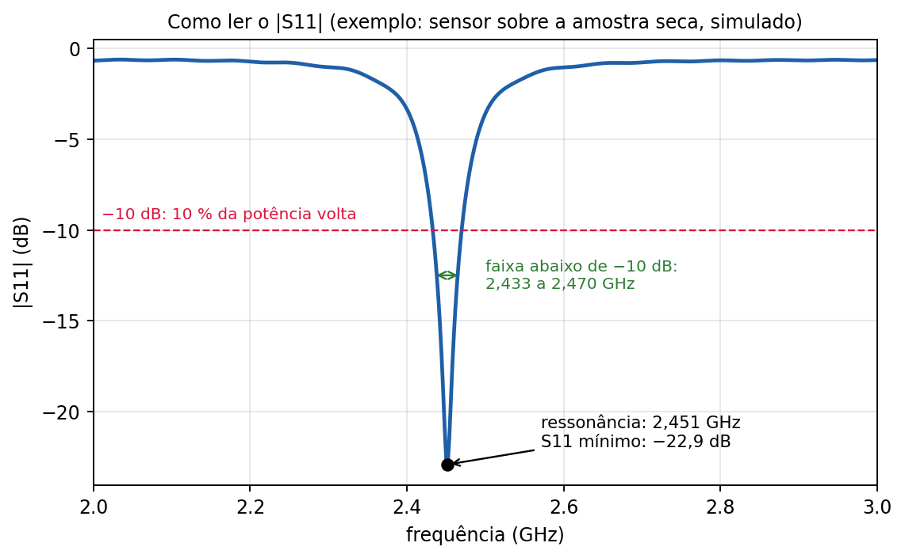
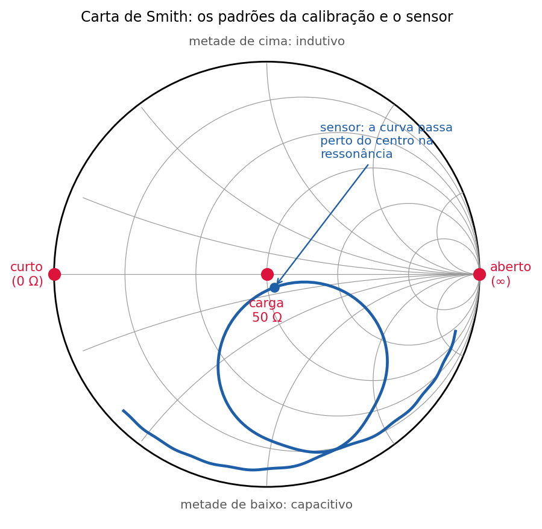
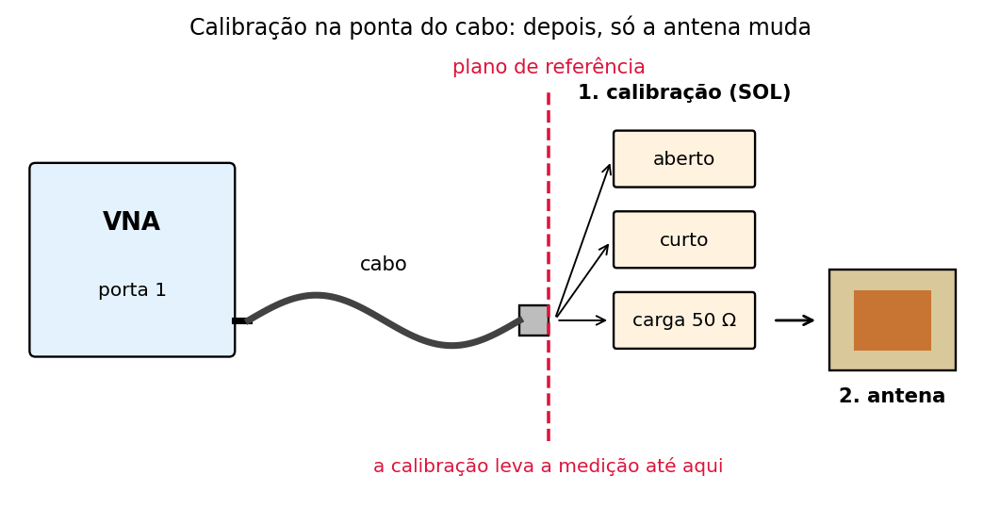

# Guia do VNA para medir antenas e sensores

<!-- pdf-cabecalho: Guia do VNA -->
<!-- pdf-subtitulo: Calibrar, medir o S11, salvar em Touchstone e comparar com a simulação -->
<!-- pdf-capa: img/s11_lido.png -->

Este guia mostra como medir o S11 de uma antena ou de um sensor com o analisador de redes
vetorial (VNA) do laboratório. Ele vale para qualquer VNA de uma ou duas portas. Os nomes dos
menus mudam de um modelo para outro, mas os passos são os mesmos.

O exemplo do guia é o sensor patch de [projetos/patch_2g45](../projetos/patch_2g45). O
roteiro do sensor diz a faixa de frequência e os resultados esperados. Este guia diz como
fazer a medição.

## Sumário

1. [O que o VNA mede](#1-o-que-o-vna-mede)
2. [Cuidados com conectores e cabos](#2-cuidados-com-conectores-e-cabos)
3. [Configurar a varredura](#3-configurar-a-varredura)
4. [Calibrar](#4-calibrar)
5. [Medir a antena](#5-medir-a-antena)
6. [Salvar em Touchstone](#6-salvar-em-touchstone)
7. [Ler e comparar no computador](#7-ler-e-comparar-no-computador)
8. [NanoVNA e LiteVNA](#8-nanovna-e-litevna)
9. [Problemas comuns](#9-problemas-comuns)
10. [Lista de verificação para imprimir](#10-lista-de-verificação-para-imprimir)

---

## 1. O que o VNA mede

O VNA envia um sinal pela porta 1 e mede a parte do sinal que volta. A razão entre o sinal
que volta e o sinal que vai é o **S11**, um número complexo para cada frequência.

- **|S11| em dB** diz quanto da potência volta. Numa antena, a potência que não volta é
  irradiada ou perdida no material.
- **A fase do S11**, ou a **carta de Smith**, diz a impedância da antena em cada frequência.
- **A ressonância** é a frequência do mínimo do |S11|.



| \|S11\| | Potência que volta | ROE (VSWR) | Interpretação |
|---|---|---|---|
| −3 dB | 50 % | 5,8 | quase nada entra na antena |
| −6 dB | 25 % | 3,0 | casamento ruim |
| −10 dB | 10 % | 1,9 | limite usual de uma antena "casada" |
| −15 dB | 3 % | 1,4 | bom |
| −20 dB | 1 % | 1,2 | muito bom |

Na carta de Smith, o centro é a impedância de 50 Ω. Quanto mais perto do centro, melhor o
casamento. Os três padrões da calibração ficam em pontos fixos: o curto à esquerda, o aberto
à direita e a carga no centro.



---

## 2. Cuidados com conectores e cabos

A porta do VNA é a peça mais cara e mais frágil do equipamento.

- **Descarga eletrostática.** Toque numa parte metálica aterrada antes de ligar um cabo. Não
  toque no pino central da porta.
- **Aperto.** Gire só a porca do conector. Não gire o corpo do conector nem o cabo.
  - Aperte com os dedos.
  - Se houver um torquímetro de SMA, use 0,56 N·m (5 lbf·in).
- **Protetor da porta.** Deixe um adaptador SMA fêmea-macho sempre na porta do VNA, e ligue
  os cabos nele. O desgaste fica no adaptador, que é barato.
- **Limpeza.** Limpe os conectores com álcool isopropílico e um cotonete, sem encharcar.
- **Cabo.** Não dobre o cabo perto dos conectores. Depois da calibração, não mova o cabo.
- **Potência.** Não ligue na porta do VNA um amplificador, um transmissor ou um circuito com
  tensão contínua.

---

## 3. Configurar a varredura

Configure a varredura antes da calibração. A calibração vale só para a varredura que estava
configurada quando você calibrou.

| Ajuste | O que faz | Valor inicial |
|---|---|---|
| Início e fim (*start*, *stop*) | a faixa de frequência | a faixa do roteiro do projeto |
| Pontos (*points*) | a quantidade de frequências na faixa | 401 a 1601 |
| Largura de banda de FI (*IF bandwidth*) | menor: menos ruído, mais lento | 1 kHz |
| Potência | o nível do sinal na porta | o valor padrão do VNA |
| Média (*averaging*) | a média de várias varreduras | desligada; ligue se a curva tiver ruído |

O passo entre as frequências é a faixa dividida pela quantidade de pontos menos um. Use um
passo menor que um décimo do efeito que você quer ver.

Por exemplo, no sensor de umidade, 1 % de água desloca a ressonância 2,9 MHz. Na faixa de
2,30 a 2,60 GHz, com 601 pontos, o passo é 0,5 MHz. Este passo mostra o deslocamento de 1 %.

---

## 4. Calibrar

A calibração SOL (*short*, *open*, *load*) tira da medição o efeito do VNA e do cabo. Depois
dela, a medição começa no conector da ponta do cabo, que é o **plano de referência**. Na
simulação, a porta fica no mesmo lugar: na borda da placa, onde entra o SMA.



1. Ligue o VNA e espere 15 minutos. O VNA muda um pouco enquanto aquece.
2. Ligue o cabo que vai ficar na antena. Use sempre o mesmo cabo, na mesma posição.
3. Configure a varredura (seção 3).
4. Abra o menu de calibração e escolha a calibração de 1 porta (SOL ou *reflection*).
5. Se o VNA pedir o kit de calibração, escolha o kit que você vai usar.
6. Ligue o **aberto** na ponta do cabo e confirme a medição do padrão.
7. Ligue o **curto** e confirme.
8. Ligue a **carga de 50 Ω** e confirme.
9. Termine a calibração (*done*, *apply* ou *save*). Confira se o VNA mostra a calibração como
   ativa.

### Conferir a calibração

Ligue de novo cada padrão e olhe a medição:

| Padrão | O que você tem de ver |
|---|---|
| carga 50 Ω | \|S11\| abaixo de −35 dB; na carta de Smith, um ponto no centro |
| curto | \|S11\| perto de 0 dB; um ponto na esquerda da carta de Smith |
| aberto | \|S11\| perto de 0 dB; um ponto na direita da carta de Smith |

Se a carga ficar acima de −35 dB, calibre de novo.

### Quando calibrar de novo

- No início de cada dia de medição.
- Depois de mudar a faixa, a quantidade de pontos ou a largura de banda de FI.
- Depois de trocar ou mover o cabo, ou de pôr ou tirar um adaptador.
- Se a temperatura da sala mudar muito.

---

## 5. Medir a antena

1. Ligue a antena na ponta do cabo, sem mover o cabo.
2. Deixe a antena longe de objetos: pelo menos 30 cm de mesas metálicas, paredes, pessoas e
   do próprio VNA. Um objeto perto da antena muda a ressonância.
3. Não toque na antena nem no cabo durante a varredura.
4. Espere duas ou três varreduras completas e confira se a curva ficou estável.
5. Salve a medição (seção 6).
6. Repita a medição três vezes, tirando e pondo a antena. A diferença entre as três medições
   mostra a repetibilidade.

Para medir um sensor sobre uma amostra, siga a montagem do roteiro do projeto. A posição do
sensor e o gap entre o sensor e a amostra mudam muito o resultado.

---

## 6. Salvar em Touchstone

Salve cada medição em Touchstone de 1 porta (`.s1p`). Este formato guarda o S11 complexo, e
todos os programas de RF leem o arquivo. Uma captura de tela não serve para comparar com a
simulação.

Um arquivo `.s1p` tem uma linha de opções e uma linha por frequência:

```
! comentário: sensor seco, 17/11/2026
# GHz S RI R 50
2.300000 0.875123 -0.312456
2.300500 0.874987 -0.313102
```

- `GHz` é a unidade da frequência (também pode ser `Hz`, `kHz` ou `MHz`).
- `RI` quer dizer parte real e parte imaginária. Outros formatos são `MA` (módulo e ângulo) e
  `DB` (dB e ângulo). O `comparar.py` lê os três.
- `R 50` é a impedância de referência, 50 Ω.

Use nomes curtos e claros, sem espaço nem acento: `ar_placa1.s1p`, `seca_amostraA.s1p`,
`umida_amostraA_2h.s1p`.

Anote também no caderno do laboratório: a data, o VNA, a faixa, os pontos, a largura de banda
de FI, o cabo, a temperatura e qualquer detalhe da montagem.

---

## 7. Ler e comparar no computador

### Com o script do projeto

Cada projeto tem um `comparar.py`, que compara a medição com a simulação. No sensor de
umidade:

```bash
python comparar.py ar.s1p
python comparar.py --amostra seca.s1p
python comparar.py --umidade seca.s1p umida_1.s1p umida_2.s1p
```

O roteiro do projeto explica cada modo.

### Com o scikit-rf, no Jupyter

O openEMS Lab já traz o scikit-rf, uma biblioteca livre de RF. Num notebook:

```python
import skrf as rf

medida = rf.Network("ar.s1p")
medida.plot_s_db()       # |S11| em dB
medida.plot_s_smith()    # carta de Smith
```

Para pôr a simulação no mesmo gráfico, leia também o arquivo `.s1p` simulado da pasta
`resultados` do projeto e chame `plot_s_db()` para ele.

---

## 8. NanoVNA e LiteVNA

Se o VNA do laboratório for um NanoVNA ou um LiteVNA, use o programa livre
[NanoVNA-Saver](https://github.com/NanoVNA-Saver/nanovna-saver) (GPL-3.0) no computador. Ele
calibra, mostra o S11 e salva em Touchstone. Baixe a versão para Windows ou Linux na página
de *releases* do programa.

- No Linux, o usuário precisa estar no grupo `dialout` para abrir a porta USB. Para isso,
  rode `sudo usermod -aG dialout $USER`, saia da sessão e entre de novo.
- Confira a faixa máxima do seu modelo. Alguns modelos medem só até 1,5 GHz, e outros chegam
  a 3 GHz ou 6 GHz.
- A calibração pelo NanoVNA-Saver segue os mesmos passos da seção 4.

---

## 9. Problemas comuns

| Sintoma | Causa provável | O que fazer |
|---|---|---|
| A curva muda quando você mexe no cabo | cabo ruim ou conector frouxo | aperte os conectores; troque o cabo; calibre de novo |
| A carga dá \|S11\| acima de −35 dB depois da calibração | calibração errada ou kit errado | calibre de novo; confira o kit escolhido |
| Não há ressonância nenhuma | antena desligada, solda fria ou faixa errada | confira a faixa; meça a continuidade do SMA à linha |
| A ressonância muda quando alguém chega perto | antena perto de objetos | afaste a antena; meça com as mãos longe |
| A curva tem ruído | largura de banda de FI alta | diminua a largura de banda de FI ou ligue a média |
| O mínimo fica entre dois pontos | passo grande | aumente os pontos ou diminua a faixa, e calibre de novo |
| A medição de hoje difere da de ontem | outra calibração, outro cabo ou outra temperatura | meça sempre uma referência (por exemplo, a amostra seca) no mesmo dia |

---

## 10. Lista de verificação para imprimir

**Antes de medir**

- [ ] VNA ligado há 15 minutos
- [ ] Adaptador protetor na porta do VNA
- [ ] Conectores limpos e apertados só pela porca
- [ ] Faixa, pontos e largura de banda de FI do roteiro do projeto

**Calibração**

- [ ] Aberto, curto e carga na ponta do cabo
- [ ] Carga abaixo de −35 dB na conferência
- [ ] Cabo parado depois da calibração

**Medição**

- [ ] Antena a 30 cm ou mais de objetos
- [ ] Curva estável antes de salvar
- [ ] Arquivo `.s1p` com nome claro
- [ ] Três repetições, tirando e pondo a antena
- [ ] Dados anotados no caderno do laboratório
