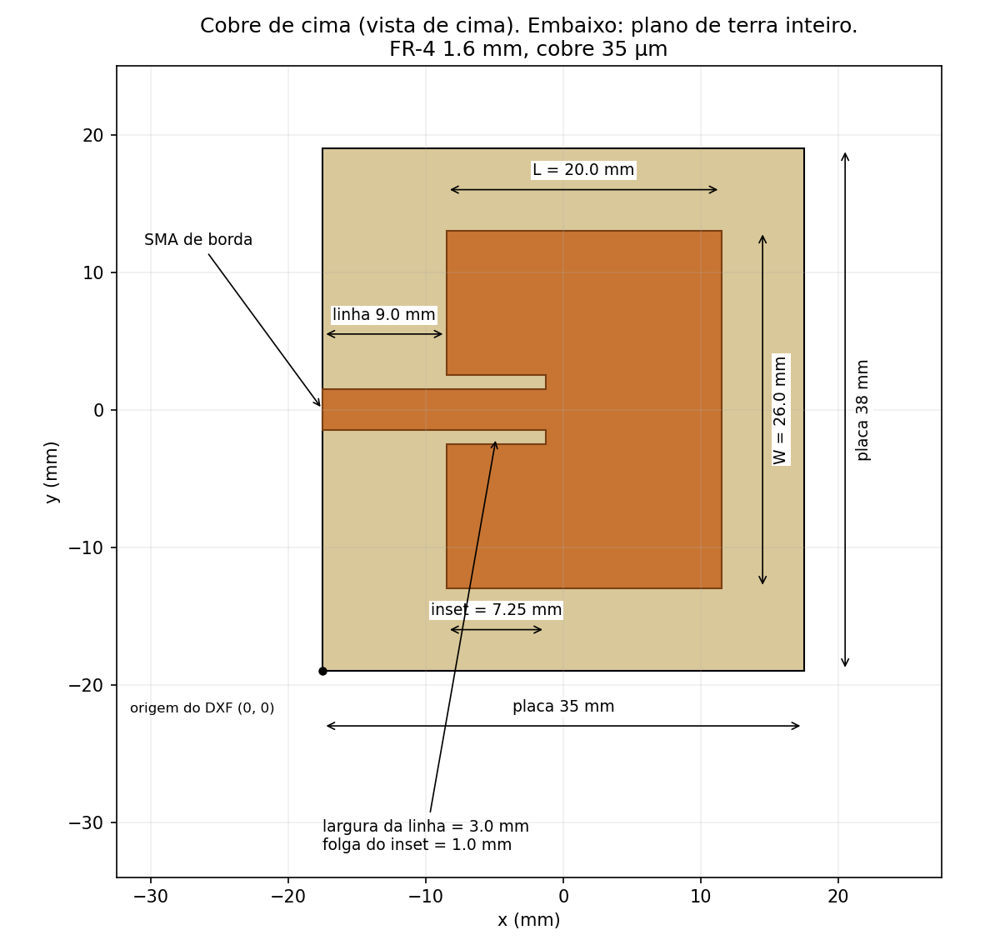
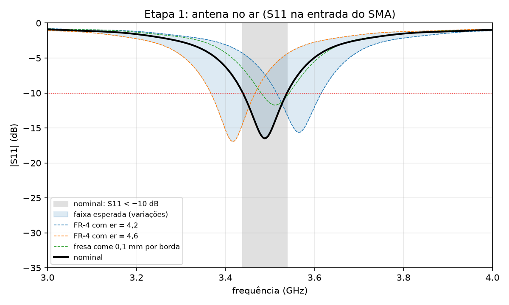
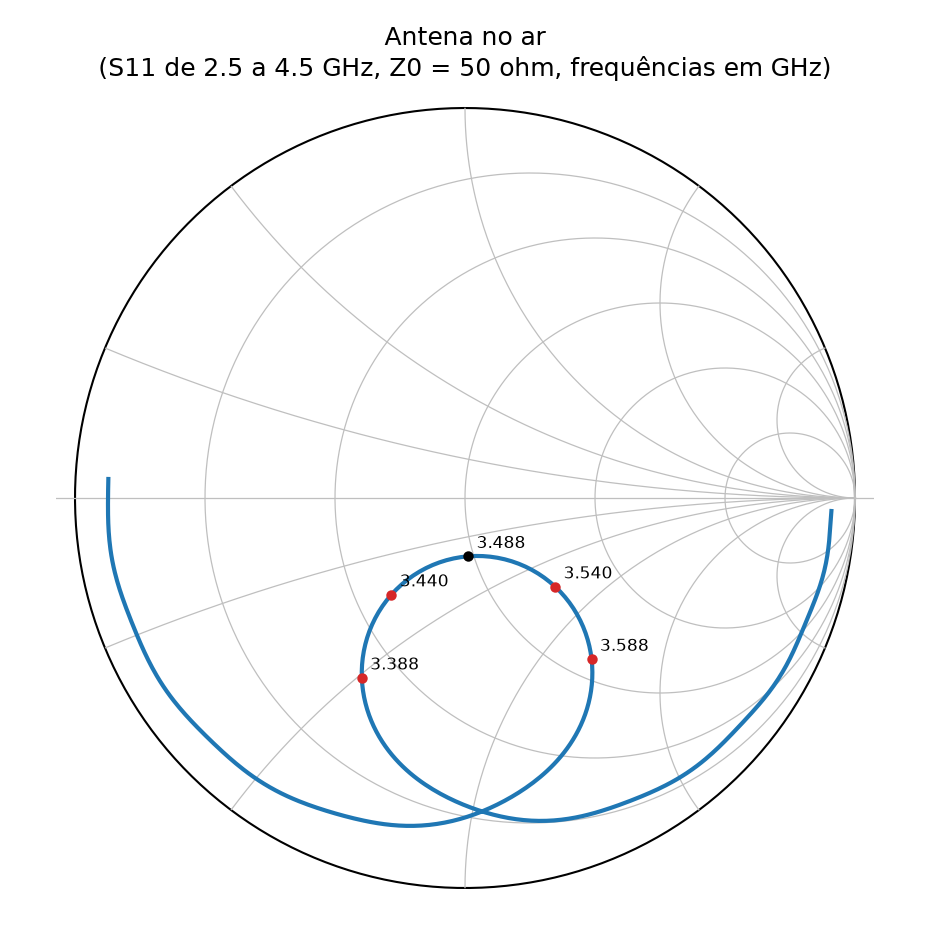
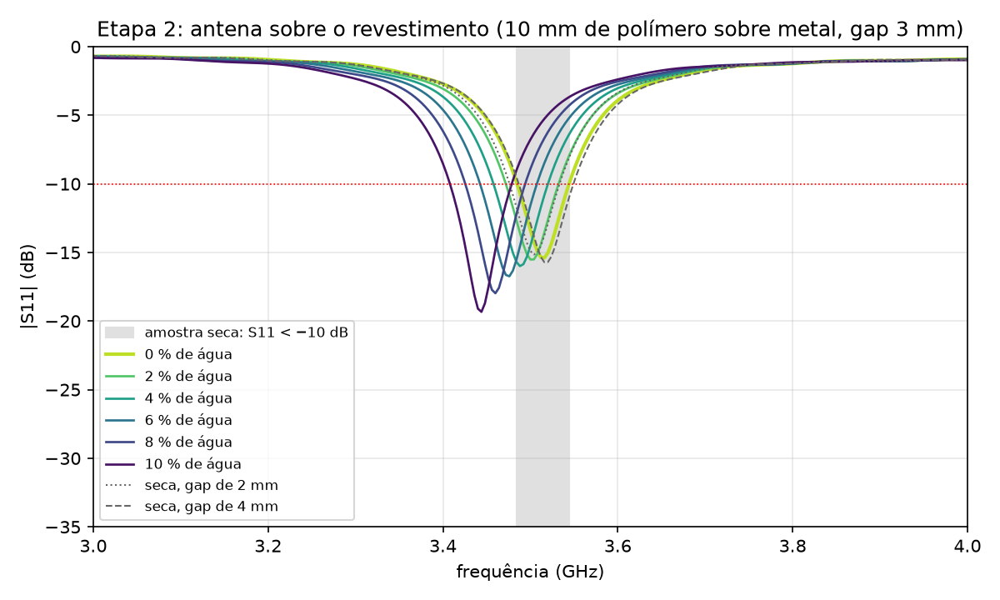
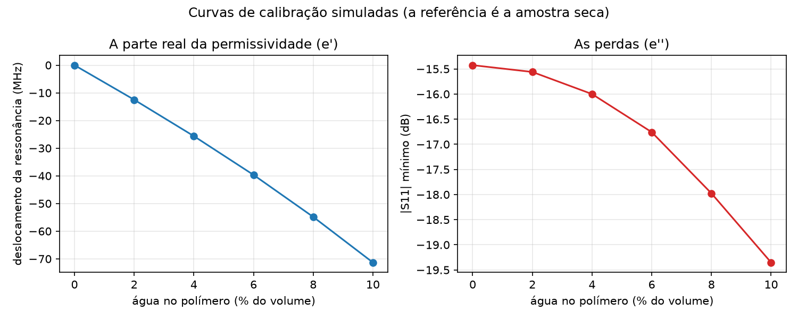
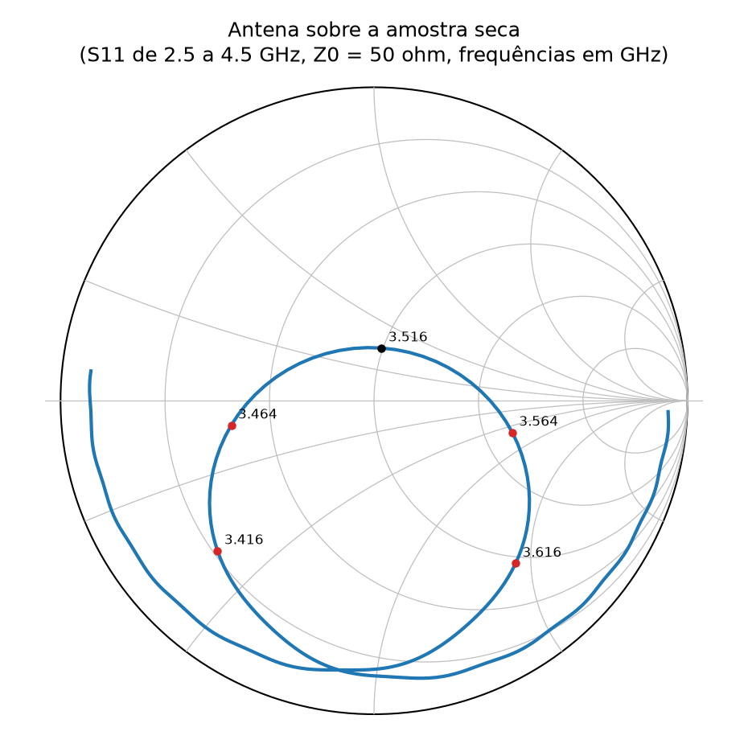

# Sensor patch de 3,5 GHz para umidade

Este projeto apresenta um sensor patch em FR-4, alimentado por microfita com inset e conector SMA de borda. O patch fica voltado para um revestimento de polímero sobre metal. Alterações na permissividade e nas perdas do revestimento mudam a frequência do mínimo de S11 e sua profundidade; essas mudanças podem ser usadas para investigar a umidade do material.

O projeto tem duas etapas: fabricar e validar a antena no ar; depois, medir o revestimento seco e úmido e comparar as medições com as simulações. Os resultados abaixo são **simulados**, não uma validação experimental. A frequência chamada de ressonância nas tabelas é a frequência do mínimo de S11.



## Geometria

A geometria padrão está definida na classe `Antena` de [`geometria.py`](geometria.py):

| Parâmetro | Valor |
|---|---:|
| Frequência de projeto | 3,5 GHz |
| Placa, comprimento × largura | 35 × 38 mm |
| Patch, L × W | 20 × 26 mm |
| Profundidade do inset | 7,25 mm |
| Folga do inset | 1,0 mm |
| Largura da linha de alimentação | 3,0 mm |
| FR-4, espessura / permissividade relativa / tangente de perdas | 1,6 mm / 4,4 / 0,02 |
| Espessura do cobre | 35 µm |

O inset de 7,25 mm foi selecionado como compromisso entre o casamento no ar e sobre a amostra seca. A busca comparou um conjunto discreto de profundidades; o valor não é uma garantia de ótimo para outros materiais ou condições de montagem.

A faixa ISM de 2,45 GHz usada como referência no projeto `patch_2g45` não é uma faixa centrada em 3,5 GHz. Neste projeto, as faixas destacadas nos gráficos S11 correspondem à **banda simulada com S11 abaixo de −10 dB** do caso nominal no ar ou da amostra seca, conforme indicado na legenda.

## Arquivos

| Arquivo | Finalidade |
|---|---|
| [`geometria.py`](geometria.py) | Dimensões da antena e geração dos arquivos de fabricação e do desenho cotado. |
| [`gerber/patch_3g50-F_Cu.gbr`](gerber/patch_3g50-F_Cu.gbr) | Cobre da face superior, para fabricação. |
| [`gerber/patch_3g50-B_Cu.gbr`](gerber/patch_3g50-B_Cu.gbr) | Plano de terra na face inferior. |
| [`gerber/patch_3g50-Edge_Cuts.gbr`](gerber/patch_3g50-Edge_Cuts.gbr) | Contorno da placa. |
| `patch_3g50.dxf`, `patch_3g50_gerber.zip` | DXF e pacote Gerber gerados por `python geometria.py`. |
| [`simular.py`](simular.py) | Simulações no ar e sobre a amostra, com openEMS. |
| [`comparar.py`](comparar.py) | Comparação entre arquivos Touchstone medidos e simulados e estimativa de umidade. |
| [`resultados/resumo.md`](resultados/resumo.md) | Tabelas completas da simulação das duas etapas. |
| `resultados/s11_ar.s1p`, `resultados/s11_amostra_seca.s1p` | S11 simulado em formato Touchstone, para comparação com o VNA. |
| `resultados/s11_ar_variacoes.csv`, `resultados/s11_amostra.csv`, `resultados/calibracao_umidade.csv` | Curvas e calibração simuladas para análise em planilha. |
| `resultados/*.png` | Desenho cotado, gráficos de S11, cartas de Smith e curvas de calibração. |

## Fabricação

Use uma placa de FR-4 de dupla face, com espessura de 1,6 mm e cobre de 35 µm, e um SMA de borda compatível. O [guia da CNC](../../fabricacao/GUIA_CNC.md) descreve o processo de fabricação; use os arquivos `patch_3g50-F_Cu.gbr` e `patch_3g50-Edge_Cuts.gbr` deste projeto. O Gerber da face inferior representa o plano de terra inteiro.

O DXF é uma alternativa para conferir a geometria em CAD ou usar em outro programa de CAM. Ele usa milímetros, com origem no canto inferior esquerdo, e contém as camadas `CONTORNO_PLACA`, `COBRE_CIMA` e `AREA_REMOVER`. Para gerar o DXF, o pacote Gerber e o desenho cotado com as dimensões atuais, execute:

```bash
python geometria.py
```

Na fabricação, remova o cobre fora do patch e da linha, inclusive nas fendas do inset, e preserve o plano de terra na face inferior. Confira com o paquímetro as dimensões, a folga do inset e a espessura da placa. Solde o SMA na borda: o pino central na linha e os terminais inferiores no plano de terra. Verifique com um multímetro que não há curto entre o pino central e o terra.

## Resultados simulados no ar

Referência de impedância de 50 Ω na borda da placa, na entrada do SMA. A varredura simulada cobre 2,5 a 4,5 GHz; os gráficos S11 exibem 3,0 a 4,0 GHz.

| Caso | Frequência do mínimo | S11 mínimo | Faixa com S11 < −10 dB |
|---|---:|---:|---:|
| Nominal, FR-4 com εr = 4,4 | 3,489 GHz | −16,5 dB | 3,439 a 3,538 GHz |
| FR-4 com εr = 4,2 | 3,565 GHz | −15,6 dB | 3,515 a 3,616 GHz |
| FR-4 com εr = 4,6 | 3,417 GHz | −16,9 dB | 3,367 a 3,467 GHz |
| Desbaste de 0,1 mm por borda | 3,512 GHz | −11,7 dB | 3,480 a 3,543 GHz |



A variação de εr desloca o mínimo: o caso com εr = 4,2 fica acima de 3,5 GHz e o de εr = 4,6, abaixo. O destaque cinza mostra a banda do caso nominal, não um limite de aceitação para todas as variações. Os resultados são úteis para orientar a comparação com a placa fabricada, mas não estabelecem uma tolerância garantida do FR-4 real.

A carta de Smith usa os mesmos dados S11 e referência de 50 Ω. Cruzar o eixo horizontal é normal: os semiplanos representam sinais diferentes da reatância.



## Medição no ar

Use um VNA que cubra 3,5 GHz; um instrumento limitado a 3 GHz não cobre a frequência de projeto. Como ponto de partida, configure uma varredura de **3,0 a 4,0 GHz**, com pelo menos 401 pontos, e calibre na ponta do cabo usando aberto, curto e carga de 50 Ω. Consulte o [guia do VNA](../../medicao/GUIA_VNA.md).

Meça a antena afastada de mãos e objetos próximos, salve o arquivo Touchstone e compare-o com a simulação:

```bash
python comparar.py ar.s1p
```

O programa informa a frequência do mínimo, o S11 e a banda abaixo de −10 dB, e gera `comparar.png`. A estimativa de εr do FR-4 é aproximada e supõe que as dimensões físicas estejam corretas; diferenças de fabricação, montagem e ambiente também podem deslocar a resposta.

## Resultados simulados sobre o revestimento

O modelo usa uma camada de **10 mm de polímero sobre metal**, separada do patch por um **gap de ar de 3 mm**. O polímero seco tem εr = 4,0 e tangente de perdas 0,01. A água é representada como fração de volume, pelo modelo de mistura CRIM; o FR-4 permanece com εr = 4,4.

| Água no polímero (% em volume) | εr / tangente de perdas | Frequência do mínimo | Deslocamento em relação à seca | S11 mínimo | Faixa com S11 < −10 dB |
|---:|---:|---:|---:|---:|---:|
| 0 | 4,00 / 0,010 | 3,514 GHz | 0 MHz | −15,4 dB | 3,485 a 3,544 GHz |
| 2 | 4,56 / 0,023 | 3,502 GHz | −12 MHz | −15,6 dB | 3,472 a 3,532 GHz |
| 4 | 5,15 / 0,034 | 3,489 GHz | −26 MHz | −16,0 dB | 3,458 a 3,520 GHz |
| 6 | 5,78 / 0,045 | 3,475 GHz | −40 MHz | −16,8 dB | 3,442 a 3,507 GHz |
| 8 | 6,45 / 0,054 | 3,460 GHz | −55 MHz | −18,0 dB | 3,425 a 3,494 GHz |
| 10 | 7,15 / 0,062 | 3,443 GHz | −71 MHz | −19,4 dB | 3,408 a 3,479 GHz |



A simulação prevê um deslocamento total de aproximadamente **−71 MHz entre 0% e 10% de água**, cerca de −7,1 MHz por ponto percentual em média. A resposta não é perfeitamente linear. Todos os mínimos da tabela ficam abaixo de −10 dB, mas a banda se desloca com a umidade: em 8% e 10%, ela já não inclui 3,5 GHz. Por isso, para acompanhar o mínimo, use uma varredura em frequência em vez de depender apenas de uma medição fixa em 3,5 GHz.





### Efeito do gap

| Gap de ar, amostra seca | Frequência do mínimo | Deslocamento em relação ao gap de 3 mm | S11 mínimo |
|---:|---:|---:|---:|
| 2 mm | 3,505 GHz | −10 MHz | −15,2 dB |
| 3 mm | 3,514 GHz | referência | −15,4 dB |
| 4 mm | 3,518 GHz | +3 MHz | −15,8 dB |

A distância entre sensor e amostra afeta a leitura. Use espaçadores e mantenha a posição e o gap constantes; a tabela mostra apenas os valores simulados para a amostra seca especificada.

## Medição sobre a amostra

1. Coloque espaçadores de 3 mm na face do patch e posicione-o voltado para o revestimento, mantendo o SMA livre para não interferir no assentamento.
2. Registre a posição do sensor e meça sempre no mesmo local. Calibre o VNA para a faixa usada; uma varredura inicial de 3,0 a 4,0 GHz cobre os resultados simulados apresentados. Uma varredura mais estreita pode melhorar a resolução, desde que inclua todos os mínimos medidos.
3. Meça e salve a amostra seca, por exemplo em `seca.s1p`, e compare com a simulação:

   ```bash
   python comparar.py --amostra seca.s1p
   ```

4. Meça e salve as amostras úmidas e use a medição seca como referência:

   ```bash
   python comparar.py --umidade seca.s1p umida_1.s1p umida_2.s1p
   ```

O programa estima a fração de água a partir do deslocamento e da curva simulada em `resultados/calibracao_umidade.csv`; resultados fora da faixa simulada são indicados como tal. Para obter uma referência independente, pese a amostra seca e úmida, retire a água superficial antes da pesagem e compare a massa absorvida com o volume do polímero. A curva simulada é um ponto de partida: uma calibração experimental para o revestimento real é necessária para verificar a precisão.

## Como refazer as simulações

No terminal do openEMS Lab, entre na pasta `projetos/patch_3g50` e execute:

```bash
python geometria.py          # gera DXF, Gerber e desenho cotado
python simular.py --etapa 1  # antena no ar: 4 simulações
python simular.py --etapa 2  # amostra: 6 teores de água e 2 gaps
python simular.py            # executa as duas etapas: 12 simulações
```

As simulações podem levar de dezenas de minutos a mais, dependendo do computador. Cada execução também gera o DXF, os Gerber, o pacote ZIP e o desenho cotado da geometria atual. Cada execução parcial grava `resumo_etapa1.md` ou `resumo_etapa2.md`; a execução completa grava `resumo.md`. Os arquivos das etapas executadas são atualizados em `resultados/`.

Para modificar a antena, edite `Antena` em `geometria.py`; para alterar a espessura, o gap ou as propriedades da amostra, edite `Amostra` em `simular.py`. Gere novamente os arquivos de fabricação depois de mudar a geometria e rode as simulações correspondentes. O modelo usa FR-4, cobre, porta de 50 Ω, materiais e dimensões idealizados; diferenças de fabricação, SMA, perdas e montagem devem ser verificadas por medição. A convergência da malha também deve ser verificada antes de tratar os valores simulados como definitivos.
